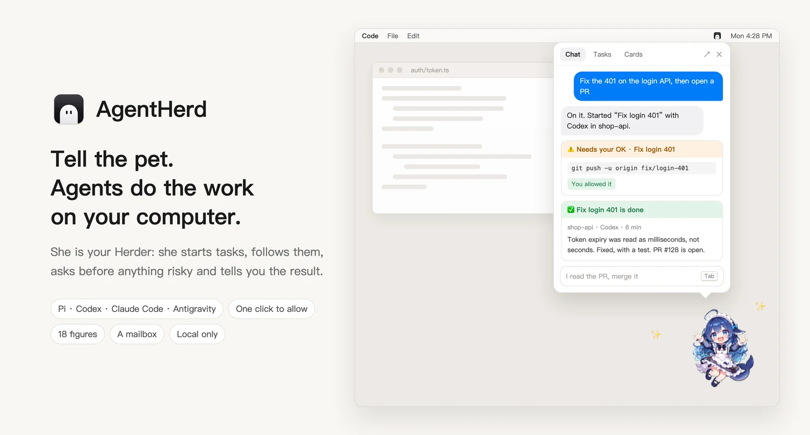

<div align="center">



English · [简体中文](README.zh-CN.md)

[](docs/spec/02-architecture.md) [](docs/spec/05-channels.md) [](https://agentclientprotocol.com) [](LICENSE)<br>
[](https://github.com/earendil-works/pi) [](https://github.com/openai/codex) [](https://github.com/anthropics/claude-code) [](https://antigravity.google)

[An example](#an-example) · [What it does](#what-it-does) · [Agents](#agents) · [Get started](#get-started) · [Docs](#docs)

</div>

> **Status:** in active development. There is no release yet; run it from source.

AgentHerd is a desktop app that lets agents such as Pi, Codex, Claude Code and Antigravity do work on your computer.

Click the pet in the corner of your screen to tell the Herder what you want. The Herder starts tasks, follows them and tells you the result in a sentence or two. Before a push, a message to someone else or a mass delete, it asks you.

## An example

1. You click the pet and say: "Fix the 401 on the login API, then open a PR."
2. The Herder starts a task, "Fix login 401", and has Codex work on a copy of shop-api.
3. When Codex wants to push the branch, a "Needs your OK" card appears in the conversation. You click Allow.
4. When it is done the pet hops and the Herder says: "Token expiry was read as milliseconds, not seconds. Fixed, with a test. PR #128 is open." Codex's own reply is one click away.

## What it does

### The Herder on your desktop

- **Click her to talk.** 大肥鱼, Claude 娘 or one of 16 anime figures sits in a corner of your screen. A click opens the conversation with the Herder, with task cards and approvals right there. Drop a file on her to hand it over.
- **See what she is doing.** She reads a book while she thinks and hops when a reply arrives; a small dot above her for each running task shows which one waits for you.
- **Out of sight, still in the loop.** System notifications, an icon in the menu bar for status, and quiet hours at night.
- **Shortcuts.** ⇧⌘Space talks to her from any app; ⇧⌘Y twice allows the oldest approval.

### Hand out work and follow it

- **The Herder keeps watch.** It picks the agent and model, follows progress, notices a stuck task, and tells you each result in its own words.
- **Tasks keep going.** Each task works on a copy of your project and is kept after it ends, so you can pick it up days later.
- **Away from your desk too.** The Herder is also in Feishu: the pet's conversation and cards are in Feishu too, so you can hand out work and approve from your phone.
- **You can see what happened.** The app shows every task's conversation, why the Herder took each step, and the tokens and cost of every request.

### It asks only when it must

- Local work goes through. A push, a pull request, a merge, a publish, a deploy, a message to someone or a mass delete asks you first, unless your request said to do it.
- Questions nobody answers close after an hour instead of nagging.
- Local only: there is no AgentHerd server. Keys and sign-ins stay in `~/.agentherd/secrets.json`.

### It watches the world around your work

- **A mailbox.** "Keep an eye on new issues in openai/codex." A GitHub repository, an RSS feed, a Hacker News search, your own script and timers are looked at by code on their own clock; only new things reach the Herder. What matters now reaches you now; the rest waits for a morning digest.
- **Your Feishu docs and calendar.** Sign in once with the official lark-cli and tasks read your docs, sheets and calendar and write results as new docs. Changing existing things asks you.
- **Plugins.** Install Claude Code plugins and Gemini CLI extensions. You see what they run before you install.
- **Memory.** The Herder remembers what to call you, what you work on, and what you corrected. You can see and edit it on the Memory page.

## Agents

| Agent | Where it comes from | Whose models |
|---|---|---|
| Pi | Comes with the app | The model services you add in the app |
| Codex | Comes with the app; takes tasks on GPT models | The model services you add in the app |
| Claude Code | Your own `claude`, or a download on the **Agent** page | Your own Anthropic-style model service |
| Antigravity | Your own `agy`, only when you ask for it | The models of your Google account |
| DeepSeek Harness | Your own DSH desktop app, only when you ask for it | The models you set up in DSH |

They all run through the [Agent Client Protocol](https://agentclientprotocol.com). If a task's first turn breaks, the Herder switches to the next model.

## Get started

Needs macOS or Windows, Node 22.18+, pnpm and a Feishu (or Lark) account.

```bash
pnpm install
pnpm --filter @agentherd/desktop fetch-agents   # from source: download Pi and Codex
pnpm --filter @agentherd/desktop start
```

The first run walks you through it: what the Herder should call you, its figure, a QR scan for Feishu, a model service and key (or a ChatGPT, Claude, Copilot or other plan), and the Herder's model. Then click the pet and tell the Herder what you want.

<details>
<summary>Windows, packaging, development and the command line</summary>

- **Windows:** run the same commands in PowerShell. Closing the window keeps AgentHerd connected in the system tray; right-click the tray icon to quit. There is no Windows installer yet.
- **macOS packaging:** `pnpm --filter @agentherd/desktop package:mac` builds `AgentHerd.app` and an unsigned `.dmg`. The packaged app includes Pi and Codex.
- **UI development:** `pnpm --filter @agentherd/desktop dev` for live reload.
- **Without the app:**

```bash
node packages/cli/bin/agentherd.ts setup feishu                                # scan the QR code with Feishu
node packages/cli/bin/agentherd.ts model add deepseek --models deepseek-flash   # reads the key from stdin
node packages/cli/bin/agentherd.ts model use herder deepseek/deepseek-flash
node packages/cli/bin/agentherd.ts start
```

Run one task with `run --profile pi /tmp/demo "Create out.txt containing hello"`, and see recent decisions with `status`.

</details>

## Docs

[Product](docs/spec/01-product.md) · [Architecture](docs/spec/02-architecture.md) · [Agents](docs/spec/03-agents.md) · [Herder](docs/spec/04-herder.md) · [Channels](docs/spec/05-channels.md) · [Security](docs/spec/06-security.md) · [ADRs](docs/adr/README.md) · [References](docs/references.md) · [AGENTS.md](AGENTS.md)

## License

AgentHerd is under the [MIT License](LICENSE).

<sub>The Herder's loop is a fork of [Pi](https://github.com/earendil-works/pi)'s agent loop (MIT, [`packages/herder-loop`](packages/herder-loop/UPSTREAM.md)). Its context management uses [acp-kernel](https://github.com/ranxianglei/acp-kernel) from [billion-context](https://github.com/ranxianglei/billion-context) (MIT plus an attribution term), copied into [`packages/context-kernel`](packages/context-kernel/UPSTREAM.md). See [References](docs/references.md). The desktop pet's figures come from community Codex pets: 大肥鱼 and Claude 娘 drawn by ZipZipPipe from [llm-pet](https://github.com/savanna0425/llm-pet), and sixteen anime figures by their makers from [awesome-codex-pet](https://github.com/legeling/awesome-codex-pet). They are not under the MIT License and may not be used commercially; the characters belong to their original works. Every figure's maker, terms and link are in the [notice](apps/desktop/src/renderer/src/pet/figures/NOTICE.md).</sub>
