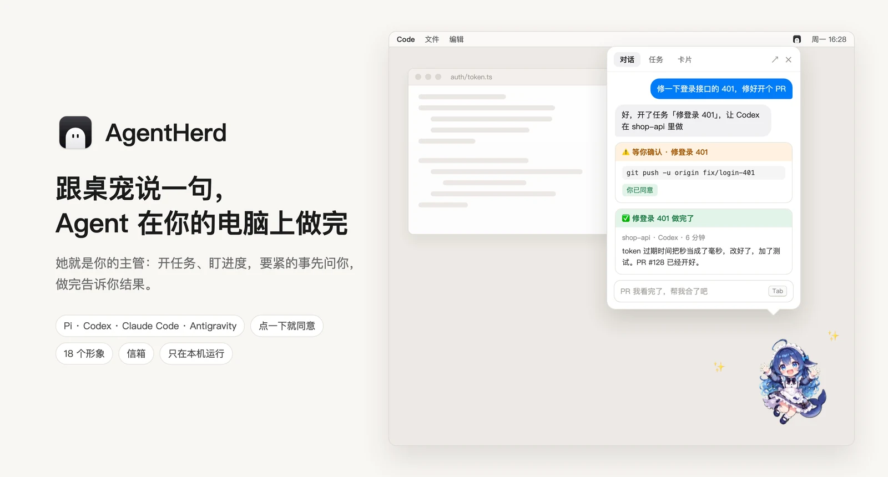

<div align="center">



[English](README.md) · 简体中文

[](docs/spec/02-architecture.md) [](docs/spec/05-channels.md) [](https://agentclientprotocol.com) [](LICENSE)<br>
[](https://github.com/earendil-works/pi) [](https://github.com/openai/codex) [](https://github.com/anthropics/claude-code) [](https://antigravity.google)

[一个例子](#一个例子) · [能做什么](#能做什么) · [支持的 Agent](#支持的-agent) · [开始使用](#开始使用) · [文档](#文档)

</div>

> **状态：** 正在开发，还没有发布版本，请从源码运行。

AgentHerd 是一个桌面 App，让 Pi、Codex、Claude Code 和 Antigravity 这些 Agent 在你的电脑上替你干活。

点一下桌面角上的桌宠，就能跟「主管」说要做什么。主管开任务、盯进度，做完用一两句话告诉你；推代码、对外发消息、一次删很多文件之前，会先问你。

## 一个例子

1. 你点一下桌宠，说：「修一下登录接口的 401，修好开个 PR」。
2. 主管开一个任务「修登录 401」，让 Codex 在 shop-api 的副本里改。
3. Codex 要推送分支时，对话里出现一张「等你确认」卡片，你点了「同意」。
4. 做完桌宠跳一下，主管说：「token 过期时间把秒当成了毫秒，改好了，加了测试，PR #128 已经开好」。Codex 的原话点一下就能看。

## 能做什么

### 桌面上的主管

- **点她就能说话。** 大肥鱼、Claude 娘或另外 16 个动漫形象浮在桌面一角。点一下就是和主管的对话，任务卡、要你同意的事都在里面；文件拖到她身上，就交给主管处理。
- **看她就知道在干什么。** 她在想时捧着书、头上冒「…」，回复到了会跳一下；头顶每个在跑的任务一个小圆点，哪个在等你一眼就看得出。
- **不在眼前也知道。** 有事会弹系统通知，菜单栏的图标能看状态，晚上可以设免打扰。
- **快捷键。** 在任何应用里按 ⇧⌘空格 直接跟她说话，按两下 ⇧⌘Y 同意最早那件等你的事。

### 派活和跟进

- **主管替你盯着。** 它挑合适的 Agent 和模型，盯进度，任务卡住了会发现，做完用自己的话告诉你。
- **任务能接着做。** 每个任务在项目的副本里干活，做完也保留，过几天还能接着说。
- **人不在电脑前也行。** 主管也在飞书里，桌宠里的对话和卡片飞书里都有，在手机上一样能派活、点同意。
- **做了什么都看得到。** App 里能看到每个任务的完整对话、主管每一步的理由，以及每次请求用了多少 token、花了多少钱。

### 只在必须时问你

- 本地的改动直接放行。推送、开或合并 PR、发布、部署、替你给别人发消息、一次删一大片文件，都会先问你；你在任务里明说过要做的，就不再问。
- 没人回的问题一小时后自动收起，不会一直催。
- 只在本机运行，没有 AgentHerd 服务器。Key 和登录凭据存在 `~/.agentherd/secrets.json`。

### 替你盯着外面

- **信箱。** 比如「盯一下 openai/codex 的新 issue」。GitHub 仓库、RSS、Hacker News 搜索、你自己写的脚本，还有定时的事，都由代码按时去看，有新东西才交给主管。要紧的马上告诉你，其余的留到早上汇总。
- **飞书文档和日程。** 用官方 lark-cli 登录一次，任务就能读你的文档、表格和日程，结果写成新文档；改已有的东西会先问你。
- **插件。** 能装 Claude Code 插件和 Gemini CLI 扩展。装之前先给你看它会运行什么。
- **记忆。** 主管记得怎么称呼你、你在做什么，也记得你纠正过它的地方。在「记忆」页能看能改。

## 支持的 Agent

| Agent | 从哪来 | 用谁的模型 |
|---|---|---|
| Pi | 随 App 一起装 | 你在 App 里加的模型服务 |
| Codex | 随 App 一起装，GPT 模型的任务交给它 | 你在 App 里加的模型服务 |
| Claude Code | 用你电脑上的 `claude`；没有的话在「Agent」页下载 | 你自己的 Anthropic 接口服务 |
| Antigravity | 用你自己装的 `agy`，你点名时才用 | 你 Google 账号里的模型 |
| DeepSeek Harness | 用你自己装的 DSH 桌面版，你点名时才用 | 你在 DSH 里配好的模型 |

它们都通过 [Agent Client Protocol](https://agentclientprotocol.com) 运行。任务第一轮就出错时，主管会自动换下一个模型。

## 开始使用

需要 macOS 或 Windows、Node 22.18+、pnpm，以及一个飞书（或 Lark）账号。

```bash
pnpm install
pnpm --filter @agentherd/desktop fetch-agents   # 从源码运行时，下载 Pi 和 Codex
pnpm --filter @agentherd/desktop start
```

第一次打开会一步步带你：告诉主管怎么称呼你、选形象、扫码接飞书、加模型服务和 Key（也可以用 ChatGPT、Claude、Copilot 等订阅账号登录）、给主管选模型。然后点一下桌宠，跟主管说要做什么就行。

<details>
<summary>Windows、打包、开发和命令行</summary>

- **Windows：** 在 PowerShell 里运行同样的命令。关掉窗口后 AgentHerd 收进系统托盘，保持连接；彻底退出要右键托盘图标。暂时没有 Windows 安装包。
- **macOS 打包：** `pnpm --filter @agentherd/desktop package:mac` 打出 `AgentHerd.app` 和 `.dmg`（暂未签名）。打包版自带 Pi 和 Codex。
- **开发界面：** `pnpm --filter @agentherd/desktop dev` 热重载。
- **不用 App，用命令行：**

```bash
node packages/cli/bin/agentherd.ts setup feishu                                # 用飞书扫码
node packages/cli/bin/agentherd.ts model add deepseek --models deepseek-flash   # 从标准输入读取 Key
node packages/cli/bin/agentherd.ts model use herder deepseek/deepseek-flash
node packages/cli/bin/agentherd.ts start
```

直接跑一个任务：`run --profile pi /tmp/demo "Create out.txt containing hello"`；看最近的决定：`status`。

</details>

## 文档

[产品](docs/spec/01-product.md) · [架构](docs/spec/02-architecture.md) · [Agent](docs/spec/03-agents.md) · [主管](docs/spec/04-herder.md) · [渠道](docs/spec/05-channels.md) · [安全](docs/spec/06-security.md) · [ADR](docs/adr/README.md) · [参考项目](docs/references.md) · [AGENTS.md](AGENTS.md)

## 许可证

AgentHerd 使用 [MIT 许可证](LICENSE)。

<sub>主管的循环 fork 自 [Pi](https://github.com/earendil-works/pi) 的 agent loop（MIT，[`packages/herder-loop`](packages/herder-loop/UPSTREAM.md)）。上下文管理用的是 [billion-context](https://github.com/ranxianglei/billion-context) 的 [acp-kernel](https://github.com/ranxianglei/acp-kernel)（MIT，另加一条署名条款），代码复制在 [`packages/context-kernel`](packages/context-kernel/UPSTREAM.md)。详见[参考项目](docs/references.md)。桌宠形象来自社区的 Codex 宠物：大肥鱼和 Claude 娘由画师 ZipZipPipe 绘制，来自 [llm-pet](https://github.com/savanna0425/llm-pet)；另外 16 个动漫形象由各自的作者制作，来自 [awesome-codex-pet](https://github.com/legeling/awesome-codex-pet)。它们不在 MIT 许可证范围内，不可商用，角色版权归原作。每个形象的作者、授权和原图链接见[说明](apps/desktop/src/renderer/src/pet/figures/NOTICE.md)。</sub>
