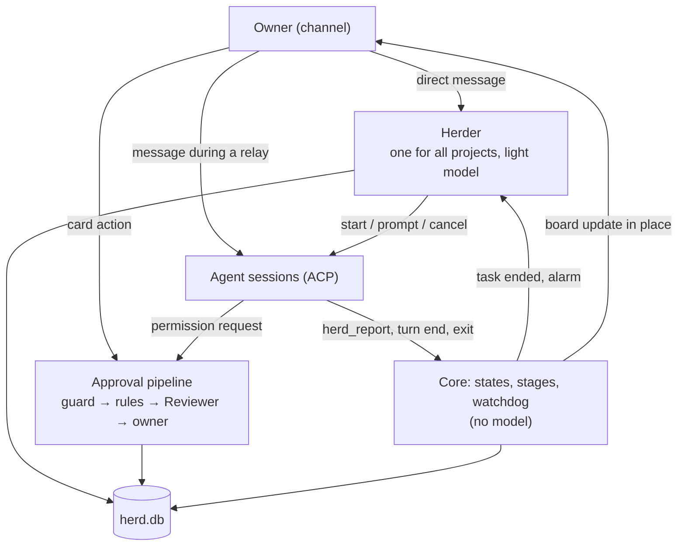
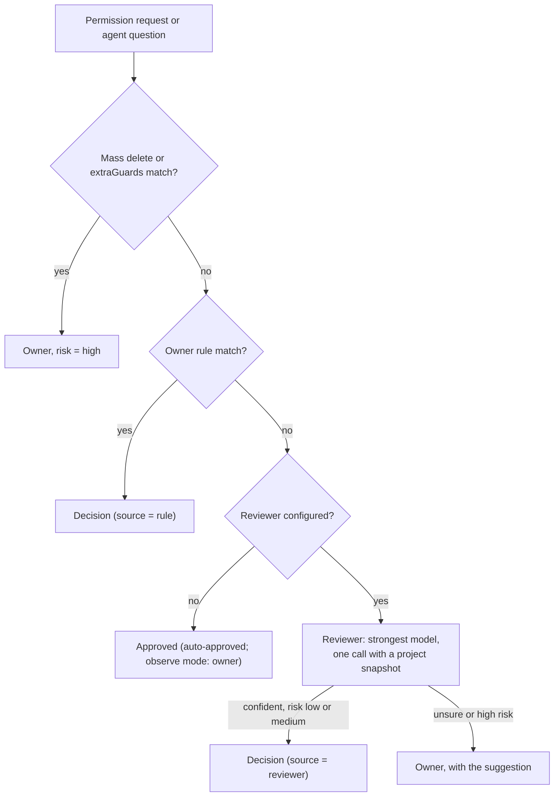

# 04. Herder and approvals

Applied ADRs: [0003](../adr/0003-herder-on-pi-agent-core.md), [0007](../adr/0007-tiered-decisions-fail-open-to-human.md),
[0008](../adr/0008-observe-first-rollout.md), [0012](../adr/0012-channel-is-the-only-decision-surface.md),
[0018](../adr/0018-one-herder-as-secretary-separate-approvals.md), [0019](../adr/0019-relay-verbatim-board-and-reports.md).

AgentHerd has three roles:

| Role | What it does | Model |
| --- | --- | --- |
| **Herder** (the secretary) | Talks with the owner, starts and steers sessions, relays the owner to a task, keeps the board, acts on watchdog alarms | One resident session, light model |
| **Approval pipeline** | Decides permission requests: guard list → rules → Reviewer → owner | Reviewer: strongest model, one call per item |
| **Agents** | Do the work | Their own models |

The Herder manages communication and scheduling, the approval pipeline decides what may run,
the agents do the work. The Herder never approves anything.



## 1. Herder

### Inbound

| Owner sends | Goes to | Model? |
| --- | --- | --- |
| A direct message, no relay active | The Herder | Yes |
| A direct message, relay active | The relayed session, verbatim | No |
| A card action (allow, deny, answer, always) | The approval pipeline / the item | No |
| `/herder <text>` during a relay | The Herder | Yes |
| `/end` or the "End relay" button | Ends the relay | No |
| `/interrupt <text>` during a relay | Cancels the current turn, then sends the text | No |
| `status` | Sends the board | No |

Images in a message go the same way as its text; how the Herder and agents get them is in
[05-channels.md §1](05-channels.md#1-channel-interface).

### What the Herder does with a direct message

1. **Not a task** (a question about state, small talk): it answers from the store.
2. **About a running task:** it asks the owner whether to relay, or sends the message to that
   session if the owner said so.
3. **A new task:** it resolves the project directory and the agent profile from the message,
   the owner's defaults and the last choice. If one of them stays unclear, it asks one
   question with a suggested answer.
4. **Capacity:** if `maxConcurrentSessions` (default 3) are running, the task is queued and
   the owner is told its place.
5. **Start:** `session/new` in the project directory, then the prompt (below). The board gets a
   new row.

### Verbatim rule

The Herder may add, never rewrite.

- The owner's words go to the agent unchanged; the agent's words go to the owner unchanged.
- Context the Herder adds is a separate, labeled block:

  ```text
  [Owner's message]
  Apply the login timeout fix to PI-Desktop too.

  [Context added by the Herder, for reference]
  - Project: /Users/.../PI-Desktop
  - "the login timeout fix" is task #12 (AgentRecall), done, PR #42
  - Report of #12: ...
  ```

- If the Herder cannot tell which task the owner means, it asks with buttons. It does not guess.
- Projects: the Herder finds folders with `project_find` and the owner always picks one with a
  button; `session_start` runs only in a folder the owner typed or picked in that message
  ([ADR 0035](../adr/0035-herder-finds-projects-owner-picks.md), spec 08 §1).

### Relay

- Start: the owner asks the Herder ("put me through to the login fix") or picks a task on the
  board. If the request matches more than one task, the Herder asks with buttons.
- During a relay, direct messages go to the session without the Herder. Agent messages come
  back with a task-name prefix. Items and reports from other tasks still arrive, each labeled
  with its task.
- A message sent while the agent is working is queued and sent as the next prompt.
  `/interrupt` cancels the current turn first.
- End: `/end`, the button, the task ends, or `relayIdleMinutes` (default 30) with no owner
  message. The owner is told "Back to the Herder".
- The active relay is stored per channel chat in `herd.db`.

### Tools

| Group | Tools |
| --- | --- |
| Sessions | `session_start(project, name, profile?, ownerText, addedContext, model?)` (name: the task's short name, shown on the board and every report, [ADR 0034](../adr/0034-herder-names-tasks.md)) (model: `service/model` the agent can run, picked by the Herder, [ADR 0025](../adr/0025-herder-picks-model-per-task.md)), `session_prompt(sessionId, text, name?)` (name renames the task), `session_cancel(sessionId)` (stops the running turn), `session_end(sessionId)` (closes the task when the owner says it is finished; the case memory is written then), `session_list()` (also lists models, the agents that can run each, and the owner's model guide, [ADR 0026](../adr/0026-model-guide-for-the-herder.md)) |
| Owner | `ask(text, options)` (AgentHerd adds 「其他」), `project_find(name)`, `notify(text)`, `relay_start(sessionId)`, `relay_end()` |
| Read | `task_get`, `task_list`, `session_transcript`, `decisions_list`, `read`, `grep`, `list`, `git_log`, `git_diff` (read tools only inside known project directories) |

There is no tool to approve an item, write files or run shell commands. Every Herder tool call
is checked by the guard list first; a match goes to the owner instead of running. Every call is
written to the audit log.

### When the Herder runs

The Herder runs only when the owner writes to it or answers its question (ADR 0033). Task
reports and watchdog alarms reach the owner by themselves; the Herder gets them, quoted as agent
data under "[Already sent to the owner]", in front of the owner's next message (the last 10), so
it knows what happened without repeating it.

### Context and restarts

- A failed Herder turn is retried, then run on the next model, then held with a 「重试」 card;
  key, balance and request errors are not retried ([ADR 0037](../adr/0037-herder-retries-and-never-drops.md), spec 08 §5).
- The session holds the conversation with the owner and short notes. Task state is read from
  `herd.db` with the read tools; after a compaction the Herder must re-read it.
- Compaction keeps unresolved owner instructions verbatim.
- The session is saved and reloaded across restarts.
- Tasks are saved in `herd.db` and come back after a restart as ended tasks. `session_prompt` to an
  ended task starts its agent again in the same folder with the same model; Pi reopens its own
  session, other agents get the earlier conversation as text ([ADR 0039](../adr/0039-tasks-kept-and-continued.md)).
- Tasks cut off by a stop or crash are not restarted on their own: after the restart the Herder
  asks the owner with buttons whether to continue them ([ADR 0040](../adr/0040-ask-before-continuing-cut-off-tasks.md)).
- Agent output is untrusted data. It is quoted, and it cannot change rules, mode or the
  Herder's instructions ([06-security.md](06-security.md)).
- If the Herder fails (model error, invalid output), the owner gets a plain message and the
  fixed commands (`status`, relay buttons on the board) still work.

## 2. Following tasks

Following tasks is code, not model work. The Herder is woken only at the end of a task or by
an alarm.

### Sources

| Source | How AgentHerd gets it |
| --- | --- |
| Session state (`working`, `waiting-approval`, `idle`, `error`, `ended`) | ACP events ([03-agents.md](03-agents.md)) |
| Agent report | MCP tool `herd_report` of the `agentherd` server, offered in `session/new` and `session/load` ([09-agent-tools.md](09-agent-tools.md)) |
| Final reply | The agent's last message when the task's turn ends |
| Watchdog | Timer, every `watchdogSeconds` (default 60) |

`herd_report(state, summary, changes?, tests?, risks?, links?)`, with `state` one of
`progress`, `waiting`, `ready`, `blocked`, `failed`, `dropped`. `summary` ≤ 600 characters.
`progress` only updates the board; the other states end or pause the task and wake the Herder.
`waiting`, `blocked` and `failed` are also sent to the owner at once ([ADR 0044](../adr/0044-tell-the-owner-at-the-right-time.md)):
「需要你：」「卡住了：」「失败了：」 and the summary, linked to the task. The same report is not sent
twice, and the end-of-turn report is left out when it would repeat it.
Without `herd_report`, the stage comes from the stop reason and session state. A report holds
for the turn it came in; the next prompt starts without one.

### Stages

The core computes one stage per task from session state and the last report. It is shown on the
board.

| Stage | When |
| --- | --- |
| `queued` | Waiting for a free slot |
| `working` | Session is working |
| `needs-owner` | An open item or an agent question |
| `stuck` | Watchdog alarm, or last report `blocked` |
| `done` | Last report `ready`, or `dropped` |
| `failed` | Last report `failed`, or the session ended with an error |

### Watchdog

A session raises an alarm when:

- the same tool call with the same arguments happens 3 times in one turn;
- 3 turns in a row end with no file change and almost the same last message;
- it is `working` for longer than `maxQuietMinutes` (default 30) with no new event;
- the agent process exits unexpectedly.

The Herder handles the alarm: it may prompt the agent, cancel the turn, or tell the owner. In
`observe` mode it only tells the owner.

### Completion report

When a task ends, the owner always gets a report ([05-channels.md](05-channels.md#2-what-the-owner-sees)):
a title (task, project, agent, duration, result) added by code, the body, and the automatic
decisions during the task.

The body is chosen by size:

1. Final reply ≤ `reportMaxChars` (default 400, [ADR 0036](../adr/0036-message-cards-by-kind.md)): the reply, verbatim.
2. Longer: AgentHerd sends the session one more prompt, labeled as from AgentHerd:

   ```text
   [AgentHerd] Summarize for the owner what you did in this task, in at most 400 characters:
   what changed, what you verified, outputs (files, commits, PR), risks or open parts.
   Do not call tools.
   ```

   The answer is the body. The full final reply is attached ("Full reply").
3. The summary turn is asked once. If it fails, calls tools, or is still too long, the body
   is the original reply, folded.

The Herder never writes or shortens the body.

### Background work

A turn that ends normally with the agent's last word a `herd_report` `progress` (no tool call
after it) still has work running (a build, tests, a subagent). No report is sent; the board says
「后台还在运行：<summary>」. After `backgroundCheckMinutes` (default 5) AgentHerd prompts the
session to check on it: still running → `progress` again, finished → a normal reply. After 6
checks the report goes out anyway. A prompt from the owner ends the wait and gets its own report;
ending the task cancels it ([ADR 0044](../adr/0044-tell-the-owner-at-the-right-time.md)).

### Acknowledgement

An agent may call `herd_ack` once per turn with one line (≤ 200 characters) about what it is
starting; the owner gets it at once ([09-agent-tools.md](09-agent-tools.md)).

### Delivery

Messages for the owner (texts, reports, alarms, relay views) go through an outbox in herd.db
(table `outbox`): stored first, deleted once the channel took them. A failed send is retried
after 2 s, doubling up to 60 s; after 24 h it is dropped and audited (`send.dropped`). What a
crash or stop left unsent goes out right after the next start. The board, approval cards and
Herder questions are sent on their own paths.

### Reply length

- Every prompt AgentHerd sends to a session gets a labeled note (ADR 0036; was the first only): replies go to a
  phone; keep each under `replyHintChars` (default 300); conclusion first; details in files
  or commit messages; no long code or logs.
- Messages are folded in the channel, not shortened ([05-channels.md](05-channels.md#2-what-the-owner-sees)).

## 3. Approval pipeline



Items from different sessions are processed in parallel. The Herder is not on this path.

Since [ADR 0029](../adr/0029-only-mass-deletes-ask-the-owner.md) only a mass delete
(`packages/rules/src/mass-delete.ts`) and the owner's `extraGuards` entries reach the owner from
an agent; everything else is approved. The built-in guard list below applies to the Herder's own
tool calls.

### Guard list (always to the owner)

Built in, can be extended, cannot be overridden by rules or models. It applies to the Herder's
own tool calls (and, before ADR 0029, to agent requests). Examples: recursive delete outside the
session's working directory, `git push --force` to a default branch, piping a download into
a shell, reading `~/.ssh`, keychains or `.env` files, changing AgentHerd's own files or the
agents' permission configs.

### Rules

A rule is a match plus an action. Match fields: agent profile, event type, tool name, command
pattern (glob on the normalized command), path scope (inside the session `cwd` or a listed
directory). Rules come from:

- the "Always do this" button on a card. The generated rule is scoped to the session's project
  directory by default; the owner can widen it later in the desktop rule editor;
- the desktop rule editor.

Matching is conservative ([plan 001](../../plans/001-workspace-protocol-and-rules.md)):
`deny` wins over `allow`; an `allow` rule with a command pattern never matches a compound
command (`pnpm test && git push`) or a command the parser cannot read (command substitution,
unbalanced quotes); a path scope checks both the paths the agent reported and the path-like
words of the command.

### Reviewer

- One structured-output call to the strongest model the user configured. No resident session.
- Input: the request (tool, command, paths), the task's owner text and last report, a project
  snapshot (git status, diff stat, `AGENTS.md` / `CLAUDE.md` excerpt), and up to 5 precedents
  ([§5](#5-decision-memory)). Agent content is quoted as untrusted data.
- Read tools (`read`, `grep`, `git_diff`) inside the project directory may be offered for hard
  cases, with a step limit.
- Output: a `Decision`. A parse error, timeout or model error sends the item to the owner.

### Output

```ts
interface Decision {
  itemId: string;
  action: "allow" | "deny" | "answer" | "escalate";
  text?: string;           // the answer
  confidence: number;      // 0..1; 1 for rules
  risk: "low" | "medium" | "high";
  source: "rule" | "reviewer" | "human";
  reason: string;          // one sentence, shown to the owner
  precedents: string[];    // ids of past decisions used
}
```

### Where owner decisions go

Applied ADR: [0012](../adr/0012-channel-is-the-only-decision-surface.md).

- Every item for the owner goes to the channel. The desktop app manages AgentHerd but is not
  where the owner answers.
- The item waits for the owner. A reminder is sent every `remindMinutes` (default 30) while
  it is open. AgentHerd never decides for the owner because time passed.
- If the channel is disconnected, the item stays in the inbox, shows in the desktop app, and
  is sent when the channel reconnects. The agent keeps waiting.
- Sessions started outside AgentHerd never reach the pipeline; they follow exported rules and
  ask in their own UI ([03-agents.md](03-agents.md#2-rule-export)).

## 4. Modes

| Mode | What AgentHerd applies by itself | Use |
| --- | --- | --- |
| `observe` | Nothing. It records the Reviewer's suggestion and later compares it with the real answer. | Default for a new install. Builds the agreement metric. |
| `assist` | Rule decisions only | After the user has rules they trust |
| `auto` | Rules, and Reviewer decisions above threshold with risk `low` or `medium` | After agreement ≥ 90% |

Mode can be set globally and overridden per project directory. The desktop app shows the
agreement metric next to the mode switch. Modes apply to approvals; the Herder's management
actions follow §1 in every mode, except that in `observe` it does not act on watchdog alarms.

## 5. Decision memory

- Every item is stored with the final decision, who made it, and the Reviewer's suggestion
  (also in `observe` mode).
- Similarity for precedents in v1: the same agent kind, the same tool, the same normalized
  command head (for example `pnpm test`, `git status`) and the same project. No embeddings in
  v1.
- The owner can mark any automatic decision as wrong. That lowers the weight of its
  precedents and offers a deny rule.
- An executed command cannot be undone. "Undo" means: remove the rule, mark the precedent
  wrong, and tell the agent in the next turn if it is still running.

## 6. Model providers

- During onboarding the user picks two models from the providers Pi supports: a fast one for
  the Herder and the strongest available one for the Reviewer. AgentHerd ships no default
  provider.
- Both steps can be skipped. Without a Herder model, the owner uses fixed commands and the
  board; without a Reviewer model, items that no rule decides go to the owner.
