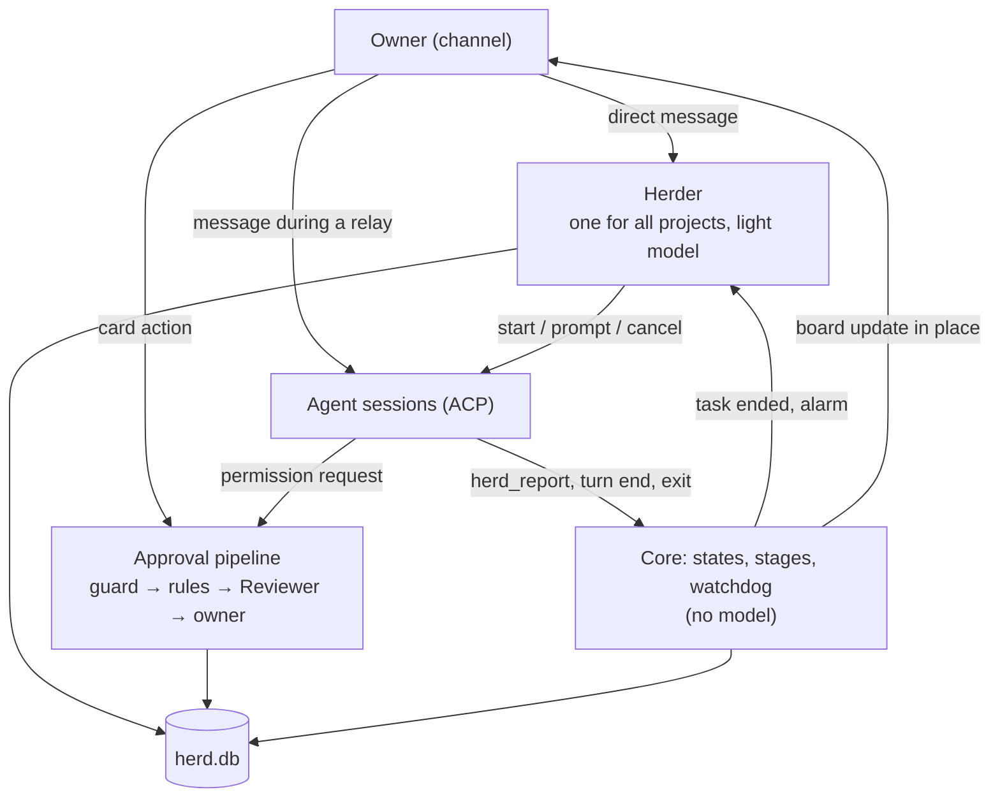
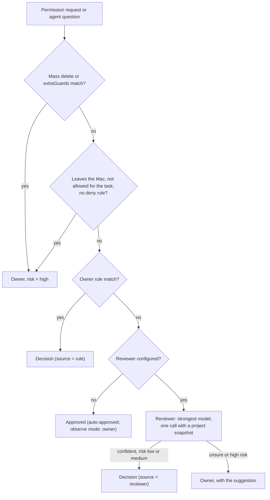

# 04. Herder and approvals

Applied ADRs: [0003](../adr/0003-herder-on-pi-agent-core.md), [0007](../adr/0007-tiered-decisions-fail-open-to-human.md),
[0008](../adr/0008-observe-first-rollout.md), [0012](../adr/0012-channel-is-the-only-decision-surface.md),
[0018](../adr/0018-one-herder-as-secretary-separate-approvals.md), [0019](../adr/0019-relay-verbatim-board-and-reports.md).

AgentHerd has three roles:

| Role | What it does | Model |
| --- | --- | --- |
| **Herder** (the secretary) | Talks with the owner, starts and steers sessions, relays the owner to a task, keeps the board, acts on watchdog alarms | One resident session, light model |
| **Approval pipeline** | Decides permission requests: guard list → rules → Reviewer → owner | Reviewer: strongest model, one call per item |
| **Agents** | Do the work | Their own models |

The Herder manages communication and scheduling, the approval pipeline decides what may run,
the agents do the work. The Herder never approves anything.



## 1. Herder

### Inbound

| Owner sends | Goes to | Model? |
| --- | --- | --- |
| A direct message, no relay active | The Herder | Yes |
| A direct message, relay active | The relayed session, verbatim | No |
| A card action (allow, deny, answer, always) | The approval pipeline / the item | No |
| `/herder <text>` during a relay | The Herder | Yes |
| `/end` or the "End relay" button | Ends the relay | No |
| `/interrupt <text>` during a relay | Cancels the current turn, then sends the text | No |
| `status` | Sends the board | No |

Images in a message go the same way as its text; how the Herder and agents get them is in
[05-channels.md §1](05-channels.md#1-channel-interface).

### What the Herder does with a direct message

1. **Not a task** (a question about state, small talk): it answers from the store.
2. **About a running task:** it asks the owner whether to relay, or sends the message to that
   session if the owner said so.
3. **A new task:** it resolves the project directory and the agent profile from the message,
   the owner's defaults and the last choice. If one of them stays unclear, it asks one
   question with a suggested answer.
4. **Capacity:** if `maxConcurrentSessions` (default 3) are running, the task is queued and
   the owner is told its place.
5. **Start:** `session/new` in the project directory, then the prompt (below). The board gets a
   new row.

### Verbatim rule

The Herder may add, never rewrite.

- The owner's words go to the agent unchanged; the agent's words go to the owner unchanged.
- Context the Herder adds is a separate, labeled block:

  ```text
  [Owner's message]
  Apply the login timeout fix to PI-Desktop too.

  [Context added by the Herder, for reference]
  - Project: /Users/.../PI-Desktop
  - "the login timeout fix" is task #12 (AgentRecall), done, PR #42
  - Report of #12: ...
  ```

- If the Herder cannot tell which task the owner means, it asks with buttons. It does not guess.
- Projects: the Herder finds folders with `project_find` and the owner always picks one with a
  button; `session_start` runs only in a folder the owner typed or picked in that message
  ([ADR 0035](../adr/0035-herder-finds-projects-owner-picks.md), spec 08 §1).

### Relay

- Start: the owner asks the Herder ("put me through to the login fix") or picks a task on the
  board. If the request matches more than one task, the Herder asks with buttons.
- During a relay, direct messages go to the session without the Herder. Agent messages come
  back with a task-name prefix. Items and reports from other tasks still arrive, each labeled
  with its task.
- A message sent while the agent is working is queued and sent as the next prompt.
  `/interrupt` cancels the current turn first.
- End: `/end`, the button, the task ends, or `relayIdleMinutes` (default 30) with no owner
  message. The owner is told "Back to the Herder".
- The active relay is stored per channel chat in `herd.db`.

### Tools

| Group | Tools |
| --- | --- |
| Sessions | `session_start(project, name, profile?, ownerText, addedContext, model?)` (name: the task's short name, shown on the board and every report, [ADR 0034](../adr/0034-herder-names-tasks.md)) (model: `service/model` the agent can run, picked by the Herder, [ADR 0025](../adr/0025-herder-picks-model-per-task.md)), `session_prompt(sessionId, text, name?)` (name renames the task), `session_cancel(sessionId)` (stops the running turn), `session_end(sessionId)` (closes the task when the owner says it is finished), `session_list()` (also lists models, the agents that can run each, and the owner's model guide, [ADR 0026](../adr/0026-model-guide-for-the-herder.md)) |
| Owner | `ask(text, options)` (AgentHerd adds 「其他」), `project_find(name)`, `notify(text)`, `relay_start(sessionId)`, `relay_end()`, `style_set(style)` (ADR 0053), `task_search(query)` (earlier tasks by title, project and last report; up to 10, [ADR 0054](../adr/0054-say-what-matters.md)) |
| Read | `task_get`, `task_list`, `session_transcript`, `decisions_list`, `read`, `grep`, `list`, `git_log`, `git_diff` (read tools only inside known project directories) |
| Schedules | `schedule_add(about, prompt, kind, at?, days?, hours?)`, `schedule_change(schedule, …, paused?)`, `schedule_remove(schedule)`: what the Herder does at set times, only when the owner asks ([ADR 0055](../adr/0055-schedules-the-herder-makes.md)) |
| Context | `compress`, `decompress`, `search_context`, `acp_status`: fold finished parts of its own conversation, find and show them again ([ADR 0045](../adr/0045-herder-context-folded-by-the-model.md)) |

There is no tool to approve an item, write files or run shell commands. Every Herder tool call
is checked by the guard list first; a match goes to the owner instead of running. Every call is
written to the audit log.

### When the Herder runs

The Herder runs only when the owner writes to it or answers its question (ADR 0033), when a
schedule the owner made is due (ADR 0055), or to tell a task's result (ADR 0053). Task
reports and watchdog alarms reach the owner by themselves; the Herder gets them, quoted as agent
data under "[Already sent to the owner]", in front of the owner's next message (the last 10), so
it knows what happened without repeating it. How each approval card was answered (allowed, refused, 「先不管」, timed
out) comes the same way; when the same kind of step comes back, the Herder may ask once whether to
keep it as a decision 「定了的事」 ([ADR 0057](../adr/0057-decisions-the-owner-made.md)), which every
later task gets and which counts as the owner allowing that step.

### Context and restarts

- A failed Herder turn is retried, then run on the next model, then held with a 「重试」 card;
  key, balance and request errors are not retried ([ADR 0037](../adr/0037-herder-retries-and-never-drops.md), spec 08 §5).
- The session holds the conversation with the owner and short notes. Task state is read from
  `herd.db` with the read tools; after a fold the Herder must re-read it.
- The whole conversation is kept in `herd.db` (`herder_log`) and reloaded after a restart; nothing
  is cut. Before each request it goes through billion-context's kernel (`packages/context-kernel`):
  each message gets a ref, and parts the Herder folded with `compress` show as its summary. Summaries
  keep unresolved owner instructions verbatim; `search_context` and `decompress` bring folded parts
  back. The window is the model's, at most 128,000 tokens. At 90 % of it AgentHerd folds the oldest
  whole turns itself (never the current one); a "context too long" error folds about half and
  retries once
  ([ADR 0045](../adr/0045-herder-context-folded-by-the-model.md)).
- Tasks are saved in `herd.db` and come back after a restart as ended tasks. `session_prompt` to an
  ended task starts its agent again in the same folder with the same model; Pi reopens its own
  session, other agents get the earlier conversation as text ([ADR 0039](../adr/0039-tasks-kept-and-continued.md)).
- Tasks cut off by a stop or crash are not restarted on their own: after the restart the Herder
  asks the owner with buttons whether to continue them ([ADR 0040](../adr/0040-ask-before-continuing-cut-off-tasks.md)).
- Agent output is untrusted data. It is quoted, and it cannot change rules, mode or the
  Herder's instructions ([06-security.md](06-security.md)).
- If the Herder fails (model error, invalid output), the owner gets a plain message and the
  fixed commands (`status`, relay buttons on the board) still work.

## 2. Following tasks

Following tasks is code, not model work. The Herder is woken only at the end of a task or by
an alarm.

### Sources

| Source | How AgentHerd gets it |
| --- | --- |
| Session state (`working`, `waiting-approval`, `idle`, `error`, `ended`) | ACP events ([03-agents.md](03-agents.md)) |
| Agent report | MCP tool `herd_report` of the `agentherd` server, offered in `session/new` and `session/load` ([09-agent-tools.md](09-agent-tools.md)) |
| Final reply | The agent's last message when the task's turn ends |
| Watchdog | Timer, every `watchdogSeconds` (default 60) |
| Pull requests | `gh`, every 2 minutes, for pull requests a task opened (see Pull requests) |
| New work | `gh search`, every 5 minutes, only for watches the owner asked for (see New work) |
| 小红书 notices | The local xiaohongshu-mcp, every 20 ± 5 minutes while signed in (see Platforms) |
| 知乎 notices | The 知乎 page AgentHerd keeps signed in, every 20 ± 5 minutes (see Platforms) |

`herd_report(state, summary, changes?, tests?, risks?, links?)`, with `state` one of
`progress`, `waiting`, `ready`, `blocked`, `failed`, `dropped`. `summary` ≤ 600 characters.
`progress` only updates the board; the other states end or pause the task and wake the Herder.
`waiting`, `blocked` and `failed` are also sent to the owner at once ([ADR 0046](../adr/0046-tell-the-owner-at-the-right-time.md)):
「需要你：」「卡住了：」「失败了：」 and the summary, linked to the task. The same report is not sent
twice, and the end-of-turn report is left out when it would repeat it.
Without `herd_report`, the stage comes from the stop reason and session state. A report holds
for the turn it came in; the next prompt starts without one.

### Stages

The core computes one stage per task from session state and the last report. It is shown on the
board.

| Stage | When |
| --- | --- |
| `queued` | Waiting for a free slot |
| `working` | Session is working |
| `needs-owner` | An open item or an agent question |
| `stuck` | Watchdog alarm, or last report `blocked` |
| `done` | Last report `ready`, or `dropped` |
| `failed` | Last report `failed`, or the session ended with an error |

### Watchdog

A session raises an alarm when:

- the same tool call with the same arguments happens 3 times in one turn;
- 3 turns in a row end with no file change and almost the same last message;
- it is `working` for longer than `maxQuietMinutes` (default 30) with no new event;
- the agent process exits unexpectedly.

The Herder handles the alarm: it may prompt the agent, cancel the turn, or tell the owner. In
`observe` mode it only tells the owner.

### Completion report

When a task ends, the owner always gets a report ([05-channels.md](05-channels.md#2-what-the-owner-sees)):
a title (task, project, agent, duration, result) added by code, the body, and the automatic
decisions during the task.

With a Herder, the body is the Herder's own words ([ADR 0053](../adr/0053-the-herder-tells-task-results.md)):
core calls `HerderPort.voice` with the task, how it ended, the agent's last reply and its
`herd_report`; the Herder answers in its style, from its conversation with the owner, without
adding or changing facts, and the agent's reply is always attached, labeled with the agent's
name (「Pi 的原话」, [ADR 0054](../adr/0054-say-what-matters.md)). How much it says follows what the owner asked: just the result
in a sentence or two; every item, one sentence each, when the owner asked which ones or what
each is; no word limit. `[quiet]`
sends nothing. A `herd_report` that needs the owner (waiting, blocked, failed) is told the same
way. When the Herder fails or takes over `VOICE_TIMEOUT_MS` (3 minutes) the body is
「主管暂时说不了话，agent 的原话在下面。」 (a notice falls back to the agent's summary).
Approval cards and other notices are not voiced.
A reply holding tool-call syntax written as text (DeepSeek's DSML, `<｜DSML｜…`) is never sent:
a voice reply falls back as if the Herder failed; an owner reply keeps the text before it, or
alerts `herderFailed` when nothing is left (audited `herder.reply.markup`).

Without a Herder, the body is at most `reportMaxWords` (default 100, see "Message length") and is
chosen in this order ([ADR 0049](../adr/0049-short-messages-written-by-the-agent.md)):

1. The turn's own `herd_report` summary, when its state is `ready`, `failed`, `blocked` or
   `waiting`.
2. The final reply, verbatim, when it fits.
3. Longer: AgentHerd sends the session one more prompt, labeled as from AgentHerd, asking for one
   or two sentences of at most 100 words for the owner (the result and what the owner must do,
   no steps), no tools. The answer is the body.
4. The summary turn is asked once. If it fails, calls tools, or is still too long, the body is
   the reply cut after 100 words with "…".

Whenever the body is not the reply, the full reply is attached ("Full reply", folded). Automatic
decisions are folded under their count.

### Background work

A turn that ends normally with the agent's last word a `herd_report` `progress` (no tool call
after it) still has work running (a build, tests, a subagent). No report is sent; the board says
「后台还在运行：<summary>」. After `backgroundCheckMinutes` (default 5) AgentHerd prompts the
session to check on it: still running → `progress` again, finished → a normal reply. After 6
checks the report goes out anyway. A prompt from the owner ends the wait and gets its own report;
ending the task cancels it ([ADR 0046](../adr/0046-tell-the-owner-at-the-right-time.md)).

### Acknowledgement

An agent may call `herd_ack` once per turn with one line (≤ 30 words) about what it is
starting; the owner gets it at once, as a reply to the owner's message that started the turn
when there is one ([09-agent-tools.md](09-agent-tools.md), ADR 0049). Turns AgentHerd starts
itself (background checks) are not acknowledged.

### Delivery

Messages for the owner (texts, reports, alarms, relay views) go through an outbox in herd.db
(table `outbox`): stored first, deleted once the channel took them. A failed send is retried
after 2 s, doubling up to 60 s; after 24 h it is dropped and audited (`send.dropped`). What a
crash or stop left unsent goes out right after the next start. The board, approval cards and
Herder questions are sent on their own paths.

### Pull requests

A task's pull requests are followed on GitHub with the owner's `gh` login, like super-agent
follows its tickets' pull requests ([ADR 0047](../adr/0047-follow-the-pull-requests-tasks-open.md)).

- **Which.** At the end of each turn, links `https://github.com/<owner>/<repo>/pull/<n>` in the
  agent's reply and `herd_report` summary are read. One is followed when its author is the `gh`
  user, it was opened after the task started and it is open; a pull request the agent only
  mentioned is not. Links in what the owner sends a task (the starting request, later prompts)
  are followed whoever opened them and in any state (`handed`, ADR 0051). Table `pr_watches` (schema 9) keeps the task, the comment and review ids
  already handled, the head commit whose failed checks were handed over, and the wake count.
- **When.** Every 2 minutes (`github.pollMinutes`). A task that is working, or whose ended turn is
  not looked at yet, is skipped: while a task works, what its account writes on GitHub is the
  agent's. After a turn, new comments by the `gh` user are marked as the agent's own.
- **People.** New comments, reviews with text, line comments and `CHANGES_REQUESTED` wake the
  task with one prompt that quotes them (labeled as from GitHub, not from the owner); the owner
  hears from the task itself (`herd_ack`, then its report), not from a separate notice
  (ADR 0049). An ended task is started again, as with any prompt (ADR 0039). A bare approval is
  only told: 「PR #n 已被 login 批准」.
- **Bots** (`type: Bot` or a login ending in `[bot]`) are marked seen and never wake or notify.
- **Checks.** When every check of the head commit finished and some failed, the task gets the
  names and how to read the logs, once per head commit; the owner hears only what the task
  reports.
- **End.** Merged or closed: the owner is told once (「PR #n 已合并」/「已关闭，没有合并」) and the
  Herder gets an event; the watch stays (`closed`), so later comments still wake the task, whose
  prompt says the pull request is closed (ADR 0051). Checks of a closed pull request are
  ignored; reopening is told once. A watch with no activity for 14 days ends silently.
  At most 20 wakes per pull request; later activity is only told.
- **Failures.** `gh` missing, logged out or offline is audited (`github.error`) once per distinct
  error; after 30 minutes the owner is told once (see Source health). `gh` runs with the
  system proxy. `agentherd run` does not follow pull requests.

### Mail

Mail is watched only when the owner asks for it ([ADR 0048](../adr/0048-watch-mail-only-when-asked.md)).

- **Asking.** 「导师来邮件提醒我」: the Herder calls `mail_watch` with the owner's words (`about`)
  and a Gmail search (`query`); `mail_unwatch` stops it; `session_list` lists watches. Only an
  owner turn can add or stop one. The tools exist only when the owner has connected apps
  (Composio, [09-agent-tools.md](09-agent-tools.md) §3). There is no setting.
- **Looking.** While at least one watch exists, every 3 minutes (`mailPollMinutes`) each search
  runs as `(<query>) after:<created>` with `GMAIL_FETCH_EMAILS` through
  `COMPOSIO_MULTI_EXECUTE_TOOL`. With no watch nothing is polled. Creating a watch runs the
  search once and fails when Gmail cannot answer.
- **Telling.** New matches are sent once: 「新邮件（<about>）：」 then sender, subject, a preview
  of at most 40 characters and the Gmail link, at most 3 per message and then 「还有 N 封」; the
  whole message stays within 100 words (fewer mails, then no previews, then cut; ADR 0049). The Herder's conversation gets the same
  as an event line marked as mail. Table `mail_watches` (schema 10) keeps watches and the ids
  told; they survive restarts.
- **Failures** are audited (`mail.error`) once per distinct error; after 30 minutes the owner
  is told once (see Source health).

### New work

New GitHub work is offered only when the owner asks for it ([ADR 0052](../adr/0052-offer-new-github-work-when-asked.md)).

- **Asking.** 「有指派给我的 issue 告诉我」「有人请我 review 就提醒我」: the Herder calls
  `intake_watch` with `kind` `issues` (open issues assigned to the owner) or `reviews`
  (open pull requests requesting their review), optionally `repo` and `label`, and `auto`
  only when the owner said such items start by themselves. The same kind/repo/label again only
  changes `auto`. `intake_unwatch` stops one; `session_list` lists them. Only an owner
  turn can add, change or stop one. The tools exist only when `gh` is set up.
- **Looking.** While a watch exists, every 5 minutes (`intakePollMinutes`) each watch runs
  `gh search issues --assignee=@me` or `gh search prs --review-requested=@me` with
  `--state=open`. Creating a watch searches once; what is there already is not new, and a
  failing `gh` refuses the watch. Failures count for source health as `github`.
- **Offering.** A new item is sent once as a question card: 「有指派给你的 issue：<repo> #n
  <title>（链接）。要开任务吗？」 with 「开任务」「忽略」. Core handles the tap: the card shows the
  choice; 「开任务」 gives the Herder an intake turn with the item's line. With `auto` the owner
  gets 「按你的规则开工：…」 and the intake turn runs at once. The Herder's conversation gets every
  new item as an event marked as new GitHub work. Table `intake_watches` (schema 12) keeps
  watches, seen items and unanswered offers.
- **The intake turn** may start a task. The title is quoted as not from the owner; only the
  repository's name picks a project without asking (ADR 0043), otherwise the Herder asks which
  folder. The task's prompt has the item's link, so its pull request is followed (ADR 0051).

### Platforms

- **小红书 and 知乎** (ADR 0058) are each turned on in 应用连接 after a risk notice and a QR sign-in. Every
  20 ± 5 minutes AgentHerd reads its unread counts and opens a notice list only when it has
  something unread; the first look of a kind only learns what is there. New comments and @ go to
  the owner one per line (three at most, then a count) and to the Herder as a `social` event;
  likes, saves and new followers are never told. `social_watch` turns this off or on when the
  owner asks; `session_list` shows platforms. Agents other than Pi use the account
  through `XIAOHONGSHU_` and `ZHIHU_` tools; writes ask (ADR 0056).
- **News and this Mac's tools** (ADR 0059). `feed_read` reads GitHub Trending, Hacker News or
  arXiv; with `told: true` (a digest, often a schedule) the items are recorded and later reads
  mark them `[told before]`, which the Herder leaves out. `session_start` adds what the host says
  the Mac offers (lark-cli signed in as the owner, the Obsidian vault) to every new task's
  context.
- **Watches list.** 应用连接 → 监听 lists pull requests, mail watches, new-work watches and
  platform kinds; pausing keeps a watch without looking (`paused` in its row), removing deletes it.

### Schedules

What the Herder does at set times, made only when the owner asks ([ADR 0055](../adr/0055-schedules-the-herder-makes.md)).

- **Making.** 「每天早上 9 点看看 PI-Desktop 有没有新 issue」: the Herder calls `schedule_add`
  with `about` (a short name), `prompt` (what to do then, complete on its own, including when to
  stay quiet) and the time: `daily` at `HH:MM` (optional `days`, 1 Monday … 7 Sunday), `every`
  N hours (1–168), or `once` at `YYYY-MM-DD HH:MM`, all in the Mac's local time. It holds at
  once, without a confirmation card; the Herder restates it in one line so the owner can
  correct it. `schedule_change` changes, pauses or resumes one, `schedule_remove` removes it,
  `session_list` lists them. Only an owner turn can make, change or remove one. At most 20.
- **Running.** Core looks every minute for due schedules (long timers are late after the Mac
  slept). A due schedule gives the Herder a scheduled turn: its prompt as the owner's words,
  so it may answer, start a task (`ownerText` is the prompt) or reply `[quiet]` to say nothing.
  A scheduled turn cannot make schedules, watches or memory. Times missed while AgentHerd was
  off or the Mac slept run once on start, not once per missed time. A `once` schedule is
  removed after it ran.
- **Keeping.** Table `schedules` (schema 13). The app's 「定时任务」 page lists them with the
  next run, and pauses, resumes or removes one.

### Source health

A source that stops answering is told once ([ADR 0050](../adr/0050-tell-the-owner-when-a-source-stops.md)).

- `SourceHealth` (`packages/core/src/source-health.ts`) keeps, per source (`github`, `mail`),
  the first failure, the last error and whether the owner was told, in store state
  `sources.health`.
- After 30 minutes of failures with no success (`sourceDownMinutes`) the owner gets one alarm
  message: which updates stopped and, when the error tells, what to do (`gh auth login`,
  install `gh`, reconnect Gmail). Audit `source.down`. The first success after it is told once
  (「PR 提醒恢复了。」, `source.up`).
- Removing the last mail watch forgets mail's failures. `session_list` shows failing sources
  to the Herder.
- The host passes the system proxy to `gh` as `HTTPS_PROXY`/`HTTP_PROXY` (Windows registry
  Internet Settings, macOS `scutil --proxy`) unless the environment has one
  (`packages/host/src/proxy.ts`).

### Message length

Every message to the owner is at most 100 words ([ADR 0049](../adr/0049-short-messages-written-by-the-agent.md)),
counted with `Intl.Segmenter("zh", { granularity: "word" })`: Chinese is split into words,
English by spaces, links count; text without word breaks is held to 8 characters per word
(`packages/core/src/owner-text.ts`). The agent writes its own short text: a `herd_report`
summary over 100 words or a `herd_ack` over 30 is refused with a tool error asking for a shorter
one. The Herder has no word limit ([ADR 0054](../adr/0054-say-what-matters.md), replacing ADR 0049 for the Herder): its replies,
`ask` and `notify` are sent as written; long messages are folded by the channel. Relay and the
board are not limited.

### Reply length

- Every prompt AgentHerd sends to a session gets a labeled note (ADR 0036; was the first only).
  With a Herder (ADR 0053): the Herder reads the reply and tells the owner; end each turn with
  what was done or found, where the results are, and what is left or needs the owner; no long
  code or logs. Without one: replies go to a phone; keep each under `replyHintChars` (default
  300); conclusion first; details in files or commit messages; no long code or logs.

### Style

The owner picks how the Herder talks ([ADR 0053](../adr/0053-the-herder-tells-task-results.md)):
`friend` 能干的朋友 (default, from open-instinct's persona), `partner` 有主见的搭档 (OpenClaw's
SOUL.md), `secretary` 干练秘书 (Vercel's personal-agent template and nanobot). It is chosen in the
first run, in Settings, or in chat (`style_set`, only on the owner's own messages), saved as
`herderStyle` in `config.json`, and read every turn: the next message uses it.

All three share one rule ([ADR 0054](../adr/0054-say-what-matters.md)): say what matters. Length follows what the owner asked,
not a number: the result in a sentence or two when that is all they want, every item when they
ask for a list, the whole of it when it matters. No filler, no steps, no 「结论：」 lines; when
there is far too much, what matters plus where the rest is. The style texts no longer carry
"say less" or "under three sentences".
- Messages are folded in the channel, not shortened ([05-channels.md](05-channels.md#2-what-the-owner-sees)).

## 3. Approval pipeline



Items from different sessions are processed in parallel. The Herder is not on this path.

From an agent, three things reach the owner
([ADR 0056](../adr/0056-leaving-the-mac-asks-and-questions-close.md), which replaced ADR 0029's
"only a mass delete"): a mass delete (`packages/rules/src/mass-delete.ts`), the owner's
`extraGuards` entries, and a step that leaves the Mac (`packages/rules/src/outbound.ts`: push,
pull-request, merge, comment, publish, deploy, send — git push, gh pr create/merge, gh issue
comment, npm publish, deploy CLIs, mail, app tools that send). Steps the owner's request asked
for pass for that task (`session_start` `allowed`, kept as `tasks.allowed_steps_json`); an
owner's deny rule beats the check; allow rules do not. Everything else is approved. The built-in
guard list below applies to the Herder's own tool calls.

An open approval gets one reminder after `remindMinutes` (30) and closes as not done after
`timeoutMinutes` (60): the agent gets a deny and goes on. 「先不管」 does the same at once.
Approvals that come up together share one card; the owner taps per line, 「全部批准」, or replies
「都批」 / 「批 1、3」 / 「拒 2」. A Herder question closes when the owner writes in the chat instead
(the Herder hears it may be the answer) or after `timeoutMinutes` (the Herder does not ask again).

### Guard list (always to the owner)

Built in, can be extended, cannot be overridden by rules or models. It applies to the Herder's
own tool calls (and, before ADR 0029, to agent requests). Examples: recursive delete outside the
session's working directory, `git push --force` to a default branch, piping a download into
a shell, reading `~/.ssh`, keychains or `.env` files, changing AgentHerd's own files or the
agents' permission configs.

### Rules

A rule is a match plus an action. Match fields: agent profile, event type, tool name, command
pattern (glob on the normalized command), path scope (inside the session `cwd` or a listed
directory). Rules come from:

- the "Always do this" button on a card. The generated rule is scoped to the session's project
  directory by default; the owner can widen it later in the desktop rule editor;
- the desktop rule editor.

Matching is conservative ([plan 001](../../plans/001-workspace-protocol-and-rules.md)):
`deny` wins over `allow`; an `allow` rule with a command pattern never matches a compound
command (`pnpm test && git push`) or a command the parser cannot read (command substitution,
unbalanced quotes); a path scope checks both the paths the agent reported and the path-like
words of the command.

### Reviewer

- One structured-output call to the strongest model the user configured. No resident session.
- Input: the request (tool, command, paths), the task's owner text and last report, a project
  snapshot (git status, diff stat, `AGENTS.md` / `CLAUDE.md` excerpt), and up to 5 precedents
  ([§5](#5-decision-memory)). Agent content is quoted as untrusted data.
- Read tools (`read`, `grep`, `git_diff`) inside the project directory may be offered for hard
  cases, with a step limit.
- Output: a `Decision`. A parse error, timeout or model error sends the item to the owner.

### Output

```ts
interface Decision {
  itemId: string;
  action: "allow" | "deny" | "answer" | "escalate";
  text?: string;           // the answer
  confidence: number;      // 0..1; 1 for rules
  risk: "low" | "medium" | "high";
  source: "rule" | "reviewer" | "human";
  reason: string;          // one sentence, shown to the owner
  precedents: string[];    // ids of past decisions used
}
```

### Where owner decisions go

Applied ADR: [0012](../adr/0012-channel-is-the-only-decision-surface.md).

- Every item for the owner goes to the channel. The desktop app manages AgentHerd but is not
  where the owner answers.
- The item waits for the owner. A reminder is sent every `remindMinutes` (default 30) while
  it is open. AgentHerd never decides for the owner because time passed.
- If the channel is disconnected, the item stays in the inbox, shows in the desktop app, and
  is sent when the channel reconnects. The agent keeps waiting.
- Sessions started outside AgentHerd never reach the pipeline; they follow exported rules and
  ask in their own UI ([03-agents.md](03-agents.md#2-rule-export)).

## 4. Modes

| Mode | What AgentHerd applies by itself | Use |
| --- | --- | --- |
| `observe` | Nothing. It records the Reviewer's suggestion and later compares it with the real answer. | Default for a new install. Builds the agreement metric. |
| `assist` | Rule decisions only | After the user has rules they trust |
| `auto` | Rules, and Reviewer decisions above threshold with risk `low` or `medium` | After agreement ≥ 90% |

Mode can be set globally and overridden per project directory. The desktop app shows the
agreement metric next to the mode switch. Modes apply to approvals; the Herder's management
actions follow §1 in every mode, except that in `observe` it does not act on watchdog alarms.

## 5. Decision memory

- Every item is stored with the final decision, who made it, and the Reviewer's suggestion
  (also in `observe` mode).
- Similarity for precedents in v1: the same agent kind, the same tool, the same normalized
  command head (for example `pnpm test`, `git status`) and the same project. No embeddings in
  v1.
- The owner can mark any automatic decision as wrong. That lowers the weight of its
  precedents and offers a deny rule.
- An executed command cannot be undone. "Undo" means: remove the rule, mark the precedent
  wrong, and tell the agent in the next turn if it is still running.

## 6. Model providers

- During onboarding the user picks two models from the providers Pi supports: a fast one for
  the Herder and the strongest available one for the Reviewer. AgentHerd ships no default
  provider.
- Both steps can be skipped. Without a Herder model, the owner uses fixed commands and the
  board; without a Reviewer model, items that no rule decides go to the owner.
