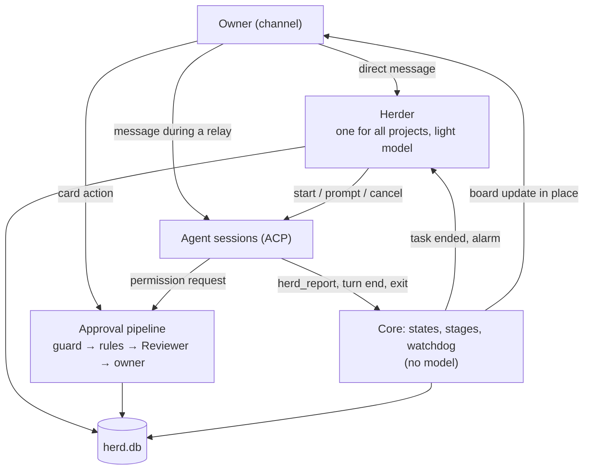
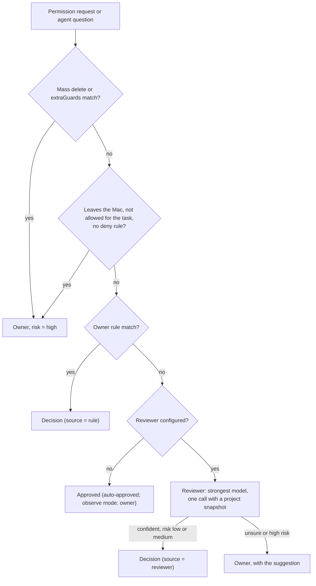

# 04. Herder and approvals

Applied ADRs: [0003](../adr/0003-herder-on-pi-agent-core.md), [0007](../adr/0007-tiered-decisions-fail-open-to-human.md),
[0008](../adr/0008-observe-first-rollout.md), [0012](../adr/0012-channel-is-the-only-decision-surface.md),
[0018](../adr/0018-one-herder-as-secretary-separate-approvals.md), [0019](../adr/0019-relay-verbatim-board-and-reports.md),
[0076](../adr/0076-westock-market-quotes-and-research-cli.md),
[0077](../adr/0077-xueqiu-danjuan-fund-holdings.md).

AgentHerd has three roles:

| Role | What it does | Model |
| --- | --- | --- |
| **Herder** (the secretary) | Talks with the owner, starts and steers sessions, relays the owner to a task, keeps the board, acts on watchdog alarms | One resident session, light model |
| **Approval pipeline** | Decides permission requests: guard list → rules → Reviewer → owner | Reviewer: strongest model, one call per item |
| **Agents** | Do the work | Their own models |

The Herder manages communication and scheduling, the approval pipeline decides what may run,
the agents do the work. The Herder never approves anything.



## 1. Herder

### Inbound

| Owner sends | Goes to | Model? |
| --- | --- | --- |
| A direct message, no relay active | The Herder | Yes |
| A direct message, relay active | The relayed session, verbatim | No |
| A card action (allow, deny, answer, always) | The approval pipeline / the item | No |
| `/herder <text>` during a relay | The Herder | Yes |
| `/end` or the "End relay" button | Ends the relay | No |
| `/interrupt <text>` during a relay | Cancels the current turn, then sends the text | No |
| `status` | Sends the board | No |

Images in a message go the same way as its text; how the Herder and agents get them is in
[05-channels.md §1](05-channels.md#1-channel-interface).

### What the Herder does with a direct message

1. **Not a task** (a question about state, small talk, a quick question about the web): it
   answers from the store, or with `web_search` / `web_read` (ADR 0071).
2. **More on a recent task** (the next step of what it did, e.g. download what a search found):
   `session_prompt` to that task, also when it ended (ADR 0071).
3. **About a running task:** it asks the owner whether to relay, or sends the message to that
   session if the owner said so.
4. **A new task:** it resolves the project directory and the agent profile from the message,
   the owner's defaults and the last choice. If one of them stays unclear, it asks one
   question with a suggested answer.
5. **Capacity:** if `maxConcurrentSessions` (default 3) are running, the task is queued and
   the owner is told its place.
6. **Start:** `session/new` in the project directory, then the prompt (below). The board gets a
   new row.

### Verbatim rule

The Herder may add, never rewrite.

- The owner's words go to the agent unchanged; the agent's words go to the owner unchanged.
- Context the Herder adds is a separate, labeled block:

  ```text
  [Owner's message]
  Apply the login timeout fix to PI-Desktop too.

  [Context added by the Herder, for reference]
  - Project: /Users/.../PI-Desktop
  - "the login timeout fix" is task #12 (AgentRecall), done, PR #42
  - Report of #12: ...
  ```

- If the Herder cannot tell which task the owner means, it asks with buttons. It does not guess.
- Projects: the Herder finds folders with `project_find` and the owner always picks one with a
  button; `session_start` runs only in a folder the owner typed or picked in that message
  ([ADR 0035](../adr/0035-herder-finds-projects-owner-picks.md), spec 08 §1).

### Relay

- Start: the owner asks the Herder ("put me through to the login fix") or picks a task on the
  board. If the request matches more than one task, the Herder asks with buttons.
- During a relay, direct messages go to the session without the Herder. Agent messages come
  back with a task-name prefix. Items and reports from other tasks still arrive, each labeled
  with its task.
- A message sent while the agent is working goes into the running turn when the agent takes it
  (Pi, through the `_agentherd/steer` extension, [ADR 0063](../adr/0063-messages-reach-a-working-pi-task.md)):
  the agent reads it after the step it is on, and the owner hears 「已插话」. Otherwise, or when
  the turn ends before reading it, it is queued and sent as the next prompt (「已排队」).
  `/interrupt` cancels the current turn first.
- End: `/end`, the button, the task ends, or `relayIdleMinutes` (default 30) with no owner
  message. The owner is told "Back to the Herder".
- The active relay is stored per channel chat in `herd.db`.

### Tools

| Group | Tools |
| --- | --- |
| Sessions | `session_start(project, name, profile?, ownerText, addedContext, model?)` (GPT models run in Codex, the rest in Pi, [ADR 0031](../adr/0031-pick-the-agent-from-the-model.md); `hard?` sends a hard coding task to Claude Code when it is installed and an Anthropic-style model fits, [ADR 0069](../adr/0069-claude-code-the-owners-own-or-downloaded.md)) (name: the task's short name, shown on the board and every report, [ADR 0034](../adr/0034-herder-names-tasks.md)) (model: `service/model` the agent can run, picked by the Herder, [ADR 0025](../adr/0025-herder-picks-model-per-task.md)), `session_prompt(sessionId, text, name?)` (name renames the task), `session_cancel(sessionId)` (stops the running turn), `session_end(sessionId)` (closes the task when the owner says it is finished), `session_list()` (also lists models, the agents that can run each, and the owner's model guide, [ADR 0026](../adr/0026-model-guide-for-the-herder.md)) |
| Owner | `ask(text, options)` (AgentHerd adds 「其他」), `project_find(name)`, `notify(text)`, `relay_start(sessionId)`, `relay_end()`, `task_search(query)` (earlier tasks by title, project and last report; up to 10, [ADR 0054](../adr/0054-say-what-matters.md)), `task_read(task, replies?)` (a task's latest reply, or its last 5, whole and quoted; at most 40,000 characters, [ADR 0062](../adr/0062-restarts-lose-nothing-and-wake-ups-stop-at-three.md)), `notice_level(kind, level)` (where one kind of small news goes: push, board or off, [ADR 0061](../adr/0061-small-news-on-the-board.md)) |
| Read | `task_get`, `task_list`, `session_transcript`, `decisions_list`, `read`, `grep`, `list`, `git_log`, `git_diff` (read tools only inside known project directories) |
| Mailbox | `mailbox_add`, `mailbox_change`, `mailbox_try`, `mailbox_list`, `mailbox_remove`, `letters_file`: sources code looks at (repositories, GitHub work, Gmail, 小红书/知乎, feeds, Hacker News, scripts) and timers, only when the owner asks ([ADR 0099](../adr/0099-a-mailbox-for-the-herder.md), [ADR 0100](../adr/0100-every-watch-and-schedule-is-a-mailbox-source.md)) |
| Context | `compress`, `decompress`, `search_context`, `acp_status`: fold finished parts of its own conversation, find and show them again ([ADR 0045](../adr/0045-herder-context-folded-by-the-model.md)) |
| Web | `web_search(query, source?, limit?)` (web results from DuckDuckGo, then Bing; `source: github` lists repositories, trying fewer words when all of them find nothing, [ADR 0085](../adr/0085-asked-for-projects-the-herder-names-real-ones.md); `source: research` asks the web, GitHub and Hacker News at once, at most 8 s, merged by link, [ADR 0086](../adr/0086-research-searches-several-sources-at-once.md)), `web_read(url, maxChars?)` (a public page as text; a GitHub repository's facts from the API; a GitHub issue page comes with its linked pull requests, open, closed and merged, from the API, [ADR 0102](../adr/0102-code-keeps-what-the-prompt-did-not.md)): read-only, public hosts only, for quick answers without a task ([ADR 0071](../adr/0071-look-things-up-and-keep-the-board-short.md)) |
| Market | `stock_quote(query)` (live A-share, HK, US, ETF and broad index quotes from Tencent Finance when 腾讯自选股 is on; read-only, zero login, objective reference only; [ADR 0076](../adr/0076-westock-market-quotes-and-research-cli.md)), `fund_holdings(days?, account?)` (personal 雪球基金 holdings and recent N-day NAV gains when signed in; read-only, [ADR 0077](../adr/0077-xueqiu-danjuan-fund-holdings.md)) |

There is no tool to approve an item, write files or run shell commands. Every Herder tool call
is checked by the guard list first; a match goes to the owner instead of running. Every call is
written to the audit log.

### When the Herder runs

The Herder runs only when the owner writes to it or answers its question (ADR 0033), when a
schedule the owner made is due (ADR 0055), or to tell a task's result (ADR 0053). Task
reports and watchdog alarms reach the owner by themselves; the Herder gets them, quoted as agent
data under "[Already sent to the owner]", in front of the owner's next message (the last 10), so
it knows what happened without repeating it. What went only on the task board or nowhere comes
under "[Not pushed to the owner]" (see Notices). How each approval card was answered (allowed, refused, 「先不管」, timed
out) comes the same way; when the same kind of step comes back, the Herder may ask once whether to
keep it as a decision 「定了的事」 ([ADR 0057](../adr/0057-decisions-the-owner-made.md)), which every
later task gets and which counts as the owner allowing that step.

### Context and restarts

- A failed Herder turn is retried, then run on the next model, then held with a 「重试」 card;
  key, balance and request errors are not retried ([ADR 0037](../adr/0037-herder-retries-and-never-drops.md), spec 08 §5).
- The owner's messages and answers wait in `herd.db` (state `herder.pending`) until their turn is
  done. After a restart the Herder takes up what is left, oldest first, each turn told that it came
  before the restart; what it already did gets `[quiet]`, and what waited more than 24 hours is
  dropped ([ADR 0062](../adr/0062-restarts-lose-nothing-and-wake-ups-stop-at-three.md)).
- The session holds the conversation with the owner and short notes. Task state is read from
  `herd.db` with the read tools; after a fold the Herder must re-read it.
- The whole conversation is kept in `herd.db` (`herder_messages`, each message with its kind, round
  and size, [ADR 0095](../adr/0095-the-herders-conversation-in-tables-and-folds-that-nest.md))
  and reloaded after a restart; nothing is cut. Before each request it goes through billion-context's kernel (`packages/context-kernel`):
  each message gets a ref (the owner's messages and tool results only; the Herder's own replies go
  without one, and a line it writes that begins like a ref tag never reaches the owner,
  [ADR 0073](../adr/0073-the-pets-conversation-looks-like-a-chat.md)), and parts the Herder folded
  with `compress` show as its summary. Summaries
  keep unresolved owner instructions verbatim; `search_context` and `decompress` bring folded parts
  back. The working window is the owner's pick on the 上下文 tab (64K, 128K by default, 256K or the
  model's whole window), never more than the model's own
  ([ADR 0097](../adr/0097-the-owner-picks-the-herders-working-window.md)). At 90 % of it AgentHerd folds the oldest
  whole turns itself (never the current one); a "context too long" error folds about half and
  retries once
  ([ADR 0045](../adr/0045-herder-context-folded-by-the-model.md)). Each fold is a row of
  `herder_folds` (who made it, what it covers, its parent once a bigger fold takes it in), and
  folds nest: a `compress` range that cuts into a fold is refused with how to take the fold in or
  leave it out (ADR 0095).
- The 主管 page's 上下文 tab shows the last request split into system prompt, memory, tools, folds,
  the owner, the Herder and tool results against the window, each request's token use and cache
  hits (`herder_requests`), a trend, every item, and the folds with their originals
  ([ADR 0093](../adr/0093-the-herders-context-panel.md)).
- No single input fills it: the owner's message goes in up to 8,000 characters (the whole is saved
  under `attachments` and the message says where), a task's reply up to 12,000, a report, event or
  new-work item up to 4,000; each cut says how much was left out. Files dropped on the pet come as
  paths, read by tasks, not by the Herder ([ADR 0083](../adr/0083-the-herder-reads-bounded-input.md)).
- Tasks are saved in `herd.db` and come back after a restart as ended tasks. `session_prompt` to an
  ended task starts its agent again in the same folder with the same model; Pi reopens its own
  session, other agents get the earlier conversation as text ([ADR 0039](../adr/0039-tasks-kept-and-continued.md)).
- Tasks cut off by a stop or crash are not restarted on their own: after the restart the Herder
  asks the owner with buttons whether to continue them ([ADR 0040](../adr/0040-ask-before-continuing-cut-off-tasks.md)).
  The first prompt a cut-off task gets tells it to look at the files, git and its pull requests
  before it goes on and not to do again what is done (ADR 0062).
- Long text given to a model keeps its start and its end with a note of how much is left out:
  a board-only result the Herder gets (1000 characters), pull request comments in a task's prompt
  (1500), saved transcript entries (20,000), the earlier conversation of a reopened task (newest
  8000). `task_read` gives the Herder a reply whole (ADR 0062).
- Agent output is untrusted data. It is quoted, and it cannot change rules, mode or the
  Herder's instructions ([06-security.md](06-security.md)).
- If the Herder fails (model error, invalid output), the owner gets a plain message and the
  fixed commands (`status`, relay buttons on the board) still work.

## 2. Following tasks

Following tasks is code, not model work. The Herder is woken only at the end of a task or by
an alarm.

### Sources

| Source | How AgentHerd gets it |
| --- | --- |
| Session state (`working`, `waiting-approval`, `idle`, `error`, `ended`) | ACP events ([03-agents.md](03-agents.md)) |
| Agent report | MCP tool `herd_report` of the `agentherd` server, offered in `session/new` and `session/load` ([09-agent-tools.md](09-agent-tools.md)) |
| Final reply | The agent's last message when the task's turn ends |
| Watchdog | Timer, every `watchdogSeconds` (default 60) |
| Pull requests | `gh`, every 2 minutes, for pull requests a task opened (see Pull requests) |
| New work | `gh search`, every 5 minutes, only for watches the owner asked for (see New work) |
| 小红书 notices | The local xiaohongshu-mcp, every 20 ± 5 minutes while signed in (see Platforms) |
| 知乎 notices | The 知乎 page AgentHerd keeps signed in, every 20 ± 5 minutes (see Platforms) |

`herd_report(state, summary, changes?, tests?, risks?, links?)`, with `state` one of
`progress`, `waiting`, `ready`, `blocked`, `failed`, `dropped`. `summary` ≤ 600 characters.
`progress` only updates the board; the other states end or pause the task and wake the Herder.
`waiting`, `blocked` and `failed` are also sent to the owner at once ([ADR 0046](../adr/0046-tell-the-owner-at-the-right-time.md)):
「需要你：」「卡住了：」「失败了：」 and the summary, linked to the task. The same report is not sent
twice, and the end-of-turn report is left out when it would repeat it.
Without `herd_report`, the stage comes from the stop reason and session state. A report holds
for the turn it came in; the next prompt starts without one.

### Stages

The core computes one stage per task from session state and the last report. It is shown on the
board.

| Stage | When |
| --- | --- |
| `queued` | Waiting for a free slot |
| `working` | Session is working |
| `needs-owner` | An open item or an agent question |
| `stuck` | Watchdog alarm, or last report `blocked` |
| `done` | Last report `ready`, or `dropped` |
| `failed` | Last report `failed`, or the session ended with an error |

A task that is `needs-owner` because of its own `waiting` report (not an open approval) and has
not changed for 30 minutes is asked about once: 「还要做 / 不做了」. 还要做 sends it back to redo what
went stale and tell the owner what to do; 不做了, or no answer for a day, stops it as `failed`.
停止 on a task that ended while it waited does the same ([ADR 0081](../adr/0081-a-waiting-task-asks-whether-it-still-matters.md)).

### Watchdog

A session raises an alarm when:

- the same tool call with the same arguments happens 3 times in one turn;
- 3 turns in a row end with no file change and almost the same last message;
- it is `working` for longer than `maxQuietMinutes` (default 30) with no new event;
- the agent process exits unexpectedly.

The Herder handles the alarm: it may prompt the agent, cancel the turn, or tell the owner. In
`observe` mode it only tells the owner.

### Completion report

When a task ends, the owner always gets a report ([05-channels.md](05-channels.md#2-what-the-owner-sees)):
a title (task, project, agent, duration, result) added by code, the body, and the automatic
decisions during the task. The one exception is a turn its pull request woke that ended done:
it goes on the board (`pr-follow-up`, see Notices).

With a Herder, the body is the Herder's own words ([ADR 0053](../adr/0053-the-herder-tells-task-results.md)):
core calls `HerderPort.voice` with the task, how it ended, the agent's last reply and its
`herd_report`; the Herder answers in its style, from its conversation with the owner, without
adding or changing facts, and the agent's reply is always attached, labeled with the agent's
name (「Pi 的原话」, [ADR 0054](../adr/0054-say-what-matters.md)). How much it says follows what the owner asked: just the result
in a sentence or two; every item, one sentence each, when the owner asked which ones or what
each is; no word limit. `[quiet]`
sends nothing. A `herd_report` that needs the owner (waiting, blocked, failed) is told the same
way. When the Herder fails or takes over `VOICE_TIMEOUT_MS` (3 minutes) the body is
「主管暂时说不了话，agent 的原话在下面。」 (a notice falls back to the agent's summary).
Approval cards and other notices are not voiced.
A reply holding tool-call syntax written as text (DeepSeek's DSML, `<｜DSML｜…`) is never sent:
a voice reply falls back as if the Herder failed; an owner reply keeps the text before it, or
alerts `herderFailed` when nothing is left (audited `herder.reply.markup`).

Without a Herder, the body is at most `reportMaxWords` (default 100, see "Message length") and is
chosen in this order ([ADR 0049](../adr/0049-short-messages-written-by-the-agent.md)):

1. The turn's own `herd_report` summary, when its state is `ready`, `failed`, `blocked` or
   `waiting`.
2. The final reply, verbatim, when it fits.
3. Longer: AgentHerd sends the session one more prompt, labeled as from AgentHerd, asking for one
   or two sentences of at most 100 words for the owner (the result and what the owner must do,
   no steps), no tools. The answer is the body.
4. The summary turn is asked once. If it fails, calls tools, or is still too long, the body is
   the reply cut after 100 words with "…".

Whenever the body is not the reply, the full reply is attached ("Full reply", folded). Automatic
decisions are folded under their count.

### Background work

A turn that ends normally with the agent's last word a `herd_report` `progress` (no tool call
after it) still has work running (a build, tests, a subagent). No report is sent; the board says
「后台还在运行：<summary>」. After `backgroundCheckMinutes` (default 5) AgentHerd prompts the
session to check on it: still running → `progress` again, finished → a normal reply. After 6
checks the report goes out anyway. A prompt from the owner ends the wait and gets its own report;
ending the task cancels it ([ADR 0046](../adr/0046-tell-the-owner-at-the-right-time.md)).

### Acknowledgement

An agent may call `herd_ack` once per turn with one line (≤ 30 words) about what it is
starting; the owner gets it at once, as a reply to the owner's message that started the turn
when there is one ([09-agent-tools.md](09-agent-tools.md), ADR 0049). Turns AgentHerd starts
itself (background checks) are not acknowledged. In a turn the owner did not ask for directly
(the Herder started or prompted the task, or its pull request woke it) the line only goes on the
board (`task-ack`, see Notices).

### Delivery

Messages for the owner (texts, reports, alarms, relay views) go through an outbox in herd.db
(table `outbox`): stored first, deleted once the channel took them. A failed send is retried
after 2 s, doubling up to 60 s; after 24 h it is dropped and audited (`send.dropped`). What a
crash or stop left unsent goes out right after the next start. The board, approval cards and
Herder questions are sent on their own paths.

### Notices

Not every notice rings the owner's phone ([ADR 0061](../adr/0061-small-news-on-the-board.md)).
Each kind of small news has a level, decided by code from what sends it, never by a model:
`push` (a message now), `board` (only the task's row on the pinned board changes) or `off` (only
the audit log, `notice`). By default these go on the board:

| Kind | What |
| --- | --- |
| `pr-approved` | a bare approval of a task's pull request |
| `pr-merged`, `pr-closed`, `pr-reopened` | a task's pull request was merged, closed, reopened |
| `pr-follow-up` | the result of a turn its pull request woke, when the task handled it (stage done) |
| `task-ack` | the `herd_ack` line of a turn the owner did not ask for directly |
| `model-switched` | a model switch (ADR 0030) in such a turn |

Everything else is always pushed: results the owner asked for (also through the Herder),
questions, approvals, a task that waits for the owner, is stuck or failed, watchdog alarms,
pull request activity no task takes, and the mail and platform notices the owner watches. The
owner changes a level by asking the Herder (`notice_level`); `session_list` shows them; herd.db
state `notice.levels` keeps the kinds that differ from the default.

Prompts carry who asked for the turn: `owner` (the owner's own message), `herder`
(`session_start`, `session_prompt`) or `pull-request`; a background check belongs to whoever
asked for the work.

**Unread messages.** When a task ends with prompts it never read, they are not dropped: the
owner's go to the Herder as the owner's message (after an `unread` event naming the task and
why it ended), and the Herder sends them again with `session_prompt` or answers; the Herder's,
or any when there is no Herder or AgentHerd is stopping, are shown to the owner
(「这条没送到：任务还没读到就结束了（…）」, the message cut at 300 characters), and a reply to
that notice opens the task again. A pull request's prompt the task never read is told by the
watch.

### Pull requests

A task's pull requests are followed on GitHub with the owner's `gh` login, like super-agent
follows its tickets' pull requests ([ADR 0047](../adr/0047-follow-the-pull-requests-tasks-open.md)).

- **Which.** At the end of each turn, links `https://github.com/<owner>/<repo>/pull/<n>` in the
  agent's reply and `herd_report` summary are read. One is followed when its author is the `gh`
  user, it was opened after the task started and it is open; a pull request the agent only
  mentioned is not. Links in what the owner sends a task (the starting request, later prompts)
  are followed whoever opened them and in any state (`handed`, ADR 0051). Table `pr_watches` (schema 9) keeps the task, the comment and review ids
  already handled, the head commit whose failed checks were handed over, and the wake count.
- **When.** Every 2 minutes (`github.pollMinutes`). A task that is working, or whose ended turn is
  not looked at yet, is skipped: while a task works, what its account writes on GitHub is the
  agent's. After a turn, new comments by the `gh` user are marked as the agent's own.
- **People.** New comments, reviews with text, line comments and `CHANGES_REQUESTED` wake the
  task with one prompt that quotes them (labeled as from GitHub, not from the owner). What the
  task does with them goes on the board when it handled them itself (`pr-follow-up`, ADR 0061);
  when the owner has to decide, the task reports `waiting` and the owner hears it at once. An
  ended task is started again, as with any prompt (ADR 0039). A bare approval only goes on the
  board: 「PR #n 已被 login 批准」 (`pr-approved`). In a turn the pull request woke, only pushes to
  its branch run without asking (see §3, ADR 0064).
- **Bots** (`type: Bot` or a login ending in `[bot]`) are marked seen and never wake or notify.
- **Checks.** When every check of the head commit finished and some failed, the task gets the
  names and how to read the logs, once per head commit; the owner hears only what the task
  reports.
- **End.** Merged or closed: the board says so once (「PR #n 已合并」/「已关闭，没有合并」,
  `pr-merged`/`pr-closed`) and the Herder gets an event; the watch stays (`closed`), so later
  comments still wake the task, whose prompt says the pull request is closed (ADR 0051). Checks
  of a closed pull request are ignored; reopening goes on the board once (`pr-reopened`). A watch
  with no activity for 14 days ends silently. At most 20 wakes per pull request; later activity
  is told to the owner, as is activity whose prompt the task never read.
- **Three in a row.** A pull request wakes its task by itself at most 3 times in a row
  (`wakesInRow`, [ADR 0062](../adr/0062-restarts-lose-nothing-and-wake-ups-stop-at-three.md)). The
  next time the task is not woken and the owner is told once (「PR #n 又有新动静（…）。任务已经连着自己处理了 3 次，
  这次先不叫它…」); more news while it waits goes on the board (「PR #n 又有新动静，等你回话」) and is held
  (`held`). The owner's reply, or anything the owner or the Herder sends the task, carries the held
  news and starts the count over.
- **Failures.** `gh` missing, logged out or offline is audited (`github.error`) once per distinct
  error; after 30 minutes the owner is told once (see Source health). `gh` runs with the
  system proxy. `agentherd run` does not follow pull requests.

### Platforms

- **小红书 and 知乎** (ADR 0058) are each turned on in 应用连接 after a risk notice and a QR sign-in. Every
  20 ± 5 minutes AgentHerd reads its unread counts and opens a notice list only when it has
  something unread; the first look of a kind only learns what is there. New comments and @ go to
  the owner one per line (three at most, then a count) and to the Herder as a `social` event;
  likes, saves and new followers are never told. Since ADR 0100 this looking is a mailbox source
  of kind `social` (added when the platform is turned on); pausing it, or the switch in 应用连接,
  stops it; `session_list` shows platforms. Agents use the account through `XIAOHONGSHU_` and
  `ZHIHU_` tools; writes ask (ADR 0056).
  The Herder's system prompt ends with the connected accounts (signed in or not) and apps, rebuilt
  on the next turn after one changes; a 小红书 or 知乎 link starts a read-only task at once when
  that account is signed in (ADR 0089).
- **News and this Mac's tools** (ADR 0059, ADR 0076, ADR 0077). `feed_read` reads GitHub Trending, Hacker News or
  arXiv; with `told: true` (a digest, often a schedule) the items are recorded and later reads
  mark them `[told before]`, which the Herder leaves out. `stock_quote` reads live stock and index
  quotes when 腾讯自选股 is enabled. `fund_holdings` reads personal 雪球基金 holdings and recent N-day
  returns when connected. `session_start` adds what the host says the computer offers
  (lark-cli signed in as the owner, the Obsidian vault, whether Tencent WeStock live quotes or the
  `westock` research CLI are available, and 雪球基金 read-only status when connected) to every new
  task's context.
### Mailbox

Things outside AgentHerd reach the Herder as letters, and what it does at set times is a timer in
the same 信箱 ([ADR 0099](../adr/0099-a-mailbox-for-the-herder.md),
[ADR 0100](../adr/0100-every-watch-and-schedule-is-a-mailbox-source.md)).

- **Sources.** Kinds `github` (a repository's new issues, pull requests, releases; optional
  words), `work` (issues assigned to the owner and pull requests asking their review, through
  `gh search`; optional repository and label), `mail` (a Gmail search through Composio, from
  when the source was made), `social` (小红书 or 知乎 comments and @; skipped while signed out; the
  notice list is opened only when something is unread), `rss`, `hn` (new stories with words,
  optional points floor), `script` (a command that reads `{"state": …}` and prints
  `{"letters": [...], "state": …}`) and `timer`. Each has the owner's sentence for the Herder and
  how often it is looked at (at least GitHub and work 5 minutes, mail 3, social 20 ± 5, RSS and HN
  15, script 1). At most 50.
- **Looking.** Code only. The first look remembers the ids that are there; later looks pass on
  ids never seen (1,000 kept per source). Three failed looks in a row are told once.
- **What a new letter does** (`act`). `sort` (default): it goes to the Herder in a `letters`
  turn, quoted under `[Letters, not from the owner]` with the source's sentence. The Herder files
  each with `letters_file` as `now`, `digest` or `noted` and a reason, tells only the `now` ones,
  or replies `[quiet]`; unfiled letters are noted. The turn cannot start, steer or end tasks. Once
  a day after 9:00 the `digest` letters come back for one short digest. `offer` (default for
  `work`): each letter is a question card 「信箱「x」来了：…要开任务吗？」 with 「开任务」「忽略」;
  「开任务」 gives the Herder an intake turn with the letter's line. `auto`: first a trial run
  (`trial`, ADR 0064): offered as above and the Herder says in one line what it would have
  started; after the owner says 「放开」 the Herder calls `mailbox_change` with `trial: false`,
  and each letter goes straight to an intake turn (「按你的规则开工（信箱「x」）：…」). The intake
  turn may start a task; only the repository's name picks a project without asking (ADR 0043).
- **Timers.** `config.when`: `daily` at `HH:MM` (optional `days`, 1 Monday … 7 Sunday), `every`
  N hours (1–168), or `once` at `YYYY-MM-DD HH:MM`, in the Mac's local time. At its time the
  Herder gets a scheduled turn with the timer's sentence as the owner's words: it may answer,
  start a task or reply `[quiet]`; when the timer's words say when to keep quiet (「没有就不用说」), code asks the model once more, with no tools, whether the reply breaks them, and holds it back on a clear QUIET ([ADR 0102](../adr/0102-code-keeps-what-the-prompt-did-not.md)); a scheduled turn cannot change sources or memory. Times missed
  while AgentHerd was off run once on start; a `once` timer is removed after it ran. 「现在做一次」
  runs it without moving the next time.
- **Adding.** 「每天早上 9 点看看 PI-Desktop 有没有新 issue」「导师来邮件提醒我」「有人请我 review
  就问我」: `mailbox_add` (kind, name, note, config, `act`, `trial`), `mailbox_try`,
  `mailbox_list`, `mailbox_change`, `mailbox_remove`; adding, changing and removing only in an
  owner turn; the Herder restates a timer in one line so the owner can correct it. The app's
  「信箱」 page does the same (each source has a ✎ button that opens the same form filled in;
  only what changed is sent, and only a new place to look — repository, feed, words, query —
  makes a source start over with a first look; a new name, note, interval or time does not),
  shows each letter's fate and reason, a timer's next run, and below
  the pull requests tasks opened (「任务开的 PR」, ADR 0051), which are not sources.
- **Keeping.** Tables `mailbox_sources`, `mailbox_letters` (schema 18; `act`, `trials`, offers in
  schema 19), last 2,000 letters. Schema 19 moved the old `schedules`, `intake_watches`,
  `mail_watches` and `social.watch` into sources and dropped them.

### Source health

A source that stops answering is told once ([ADR 0050](../adr/0050-tell-the-owner-when-a-source-stops.md)).

- `SourceHealth` (`packages/core/src/source-health.ts`) keeps, for `github` (pull requests),
  the first failure, the last error and whether the owner was told, in store state
  `sources.health`.
- After 30 minutes of failures with no success (`sourceDownMinutes`) the owner gets one alarm
  message: which updates stopped and, when the error tells, what to do (`gh auth login`,
  install `gh`, reconnect Gmail). Audit `source.down`. The first success after it is told once
  (「PR 提醒恢复了。」, `source.up`).
- Mailbox sources count their own failures (see Mailbox). `session_list` shows failing sources
  to the Herder.
- The host passes the system proxy to `gh` as `HTTPS_PROXY`/`HTTP_PROXY` (Windows registry
  Internet Settings, macOS `scutil --proxy`) unless the environment has one
  (`packages/host/src/proxy.ts`).
- The host's own model requests use the same proxy, carried by the request rather than by the
  environment (ADR 0098): the Herder's and its tasks' streams, 模型 → 测试 and listing a custom
  service's models go through `EnvHttpProxyAgent` (`packages/herder/src/model-fetch.ts`), and
  `NO_PROXY` defaults to keeping `api.deepseek.com` direct. Model requests always bypass a valid
  proxy for `localhost`, `127.0.0.1` and `[::1]`. Invalid proxy settings return a model or probe
  error without exposing the proxy URL or retrying the request directly.

### Message length

Every message to the owner is at most 100 words ([ADR 0049](../adr/0049-short-messages-written-by-the-agent.md)),
counted with `Intl.Segmenter("zh", { granularity: "word" })`: Chinese is split into words,
English by spaces, links count; text without word breaks is held to 8 characters per word
(`packages/core/src/owner-text.ts`). The agent writes its own short text: a `herd_report`
summary over 100 words or a `herd_ack` over 30 is refused with a tool error asking for a shorter
one. The Herder has no word limit ([ADR 0054](../adr/0054-say-what-matters.md), replacing ADR 0049 for the Herder): its replies,
`ask` and `notify` are sent as written; long messages are folded by the channel. Relay and the
board are not limited.

### Reply length

- Every prompt AgentHerd sends to a session gets a labeled note (ADR 0036; was the first only).
  With a Herder (ADR 0053): the Herder reads the reply and tells the owner; end each turn with
  what was done or found, where the results are, and what is left or needs the owner; no long
  code or logs. Without one: replies go to a phone; keep each under `replyHintChars` (default
  300); conclusion first; details in files or commit messages; no long code or logs.

### Style

The Herder has one voice, a capable friend, copied nearly word for word from open-instinct's
persona ([ADR 0065](../adr/0065-one-herder-voice-and-a-trail-only-herder-page.md); the owner could
pick among three styles before, ADR 0053). There is nothing to pick: a switch muddled the tone
with the older replies and rebuilt the whole prompt cache.

It follows one rule ([ADR 0054](../adr/0054-say-what-matters.md)): say what matters. Length follows what the owner asked,
not a number: the result in a sentence or two when that is all they want, every item when they
ask for a list, the whole of it when it matters. No filler, no steps, no 「结论：」 lines; when
there is far too much, what matters plus where the rest is. The style text no longer carries
"say less" or "under three sentences".

It cares about the owner ([ADR 0088](../adr/0088-the-herder-cares-and-writes-plain-chinese.md)): after the answer, one short
line when there is a reason. From midnight to 5 a.m. the time line before each message ends with
"late at night", and the first reply after midnight ends with a line telling the owner to get some
sleep (once a night). Tired, ill, upset, hours at it or a failure they cared about get one line
that shows the Herder noticed. Empty politeness (「好的！」「希望对你有帮助」) stays out. The owner
found a bare time at 01:55 cold (「这里其实我希望能回复一个早点睡」, 2026-11-20). Its Chinese reads
like a person wrote it: no 「不是……而是……」 when nothing is compared, no opening or closing
summary, no jargon (落地、对齐、钉死), full two-character words, no plan in front of the answer,
nothing about what was ruled out, no trace of a corrected mistake, no remarks on how much work
something is.
Like a text message, no line of a reply ends with 「。」: AgentHerd drops it before the reply is
said or kept (code and herd-ui blocks untouched); the owner: 「不要加句号」 (2026-11-20).

It is written for a phone: several things with details of their own (repositories, options,
files, findings) go one per line starting with "- ", never run together in one paragraph; a
question to the owner goes on its own line after a blank line; a long answer is split into short
paragraphs. The owner found a list of five repositories run together in one block hard to read
(「完全粘在一起，这一大段话，没有换行之类的」, 2026-11-18); `stylePrompt()` and the report prompt
(`voicePrompt`) both say so.
Things that read better as components go in a ```` ```herd-ui ```` block after a sentence or two of
words ([ADR 0074](../adr/0074-the-herder-draws-with-herd-ui-blocks.md)): things compared → a table,
several numbers → stats, three or more steps → steps, a repository or page → a link, a file → a
file, a command → code, a risk → a callout, an offer at the end → choices (a press comes back as
the owner's answer). The block is repaired before sending; a block with nothing usable gets one
rewrite in the same turn, then only the words go.

- Messages are folded in the channel, not shortened ([05-channels.md](05-channels.md#2-what-the-owner-sees)).

## 3. Approval pipeline



Items from different sessions are processed in parallel. The Herder is not on this path.

From an agent, three things reach the owner
([ADR 0056](../adr/0056-leaving-the-mac-asks-and-questions-close.md), which replaced ADR 0029's
"only a mass delete"): a mass delete (`packages/rules/src/mass-delete.ts`; never anything inside `/tmp` or the
system's temporary folder, ADR 0029), the owner's
`extraGuards` entries, and a step that leaves the Mac (`packages/rules/src/outbound.ts`: push,
pull-request, merge, comment, publish, deploy, send — git push, gh pr create/merge, gh issue
comment, npm publish, deploy CLIs, mail, app tools that send). Steps the owner's request asked
for pass for that task (`session_start` `allowed`, kept as `tasks.allowed_steps_json`); an
owner's deny rule beats the check; allow rules do not. Everything else is approved. The built-in
guard list below applies to the Herder's own tool calls.

Permission follows the work ([ADR 0064](../adr/0064-permission-follows-the-work-and-intake-starts-on-trial.md)):

- **Checked against the owner's words.** `session_start` keeps a step in `allowed` only when the
  owner's words this turn (their message, the answer they tapped, a schedule's saved words) or the
  words behind a kept decision (`[记忆 · 定了的事]`) name it (`stepsSaidIn` in
  `packages/rules/src/outbound.ts`, which skips negated words such as 「不用开 PR」). An intake
  turn's item line is someone else's words and allows nothing. A dropped step is audited
  (`task.allowed-dropped`) and asks the owner like any other.
- **A turn a pull request woke** may only push to that pull request's branch (`pr_watches.branch`
  from `gh pr view`'s `headRefName`): `git push` naming only those branches, or a bare push from a
  folder checked out on one. A push with `--all`, `--tags`, `--mirror`, a deletion, another
  branch, or an unparsable command, and every other step leaving the Mac (comments, merges, app
  calls), asks the owner again, with 「这一轮是 PR 上的新动静唤醒的…」 on the card. Turns the owner
  or the Herder asked for use what the owner allowed as before.

An open approval gets one reminder after `remindMinutes` (30) and closes as not done after
`timeoutMinutes` (60): the agent gets a deny and goes on. 「先不管」 does the same at once.
Approvals that come up together share one card; the owner taps per line, 「全部批准」, or replies
「都批」 / 「批 1、3」 / 「拒 2」. A Herder question closes when the owner writes in the chat instead
(the Herder hears it may be the answer) or after `timeoutMinutes` (the Herder does not ask again).

### Guard list (always to the owner)

Built in, can be extended, cannot be overridden by rules or models. It applies to the Herder's
own tool calls (and, before ADR 0029, to agent requests). Examples: recursive delete outside the
session's working directory, `git push --force` to a default branch, piping a download into
a shell, reading `~/.ssh`, keychains or `.env` files, changing AgentHerd's own files or the
agents' permission configs.

### Rules

A rule is a match plus an action. Match fields: agent profile, event type, tool name, command
pattern (glob on the normalized command), path scope (inside the session `cwd` or a listed
directory). Rules come from:

- the "Always do this" button on a card. The generated rule is scoped to the session's project
  directory by default; the owner can widen it later in the desktop rule editor;
- the desktop rule editor.

Matching is conservative ([plan 001](../../plans/001-workspace-protocol-and-rules.md)):
`deny` wins over `allow`; an `allow` rule with a command pattern never matches a compound
command (`pnpm test && git push`) or a command the parser cannot read (command substitution,
unbalanced quotes); a path scope checks both the paths the agent reported and the path-like
words of the command.

### Reviewer

- One structured-output call to the strongest model the user configured. No resident session.
- Input: the request (tool, command, paths), the task's owner text and last report, a project
  snapshot (git status, diff stat, `AGENTS.md` / `CLAUDE.md` excerpt), and up to 5 precedents
  ([§5](#5-decision-memory)). Agent content is quoted as untrusted data.
- Read tools (`read`, `grep`, `git_diff`) inside the project directory may be offered for hard
  cases, with a step limit.
- Output: a `Decision`. A parse error, timeout or model error sends the item to the owner.

### Output

```ts
interface Decision {
  itemId: string;
  action: "allow" | "deny" | "answer" | "escalate";
  text?: string;           // the answer
  confidence: number;      // 0..1; 1 for rules
  risk: "low" | "medium" | "high";
  source: "rule" | "reviewer" | "human";
  reason: string;          // one sentence, shown to the owner
  precedents: string[];    // ids of past decisions used
}
```

### Where owner decisions go

Applied ADR: [0012](../adr/0012-channel-is-the-only-decision-surface.md).

- Every item for the owner goes to the channel. The desktop app manages AgentHerd but is not
  where the owner answers.
- The item waits for the owner. A reminder is sent every `remindMinutes` (default 30) while
  it is open. AgentHerd never decides for the owner because time passed.
- If the channel is disconnected, the item stays in the inbox, shows in the desktop app, and
  is sent when the channel reconnects. The agent keeps waiting.
- Sessions started outside AgentHerd never reach the pipeline; they follow exported rules and
  ask in their own UI ([03-agents.md](03-agents.md#2-rule-export)).

## 4. Modes

| Mode | What AgentHerd applies by itself | Use |
| --- | --- | --- |
| `observe` | Nothing. It records the Reviewer's suggestion and later compares it with the real answer. | Default for a new install. Builds the agreement metric. |
| `assist` | Rule decisions only | After the user has rules they trust |
| `auto` | Rules, and Reviewer decisions above threshold with risk `low` or `medium` | After agreement ≥ 90% |

Mode can be set globally and overridden per project directory. The desktop app shows the
agreement metric next to the mode switch. Modes apply to approvals; the Herder's management
actions follow §1 in every mode, except that in `observe` it does not act on watchdog alarms.

## 5. Decision memory

- Every item is stored with the final decision, who made it, and the Reviewer's suggestion
  (also in `observe` mode).
- Similarity for precedents in v1: the same agent kind, the same tool, the same normalized
  command head (for example `pnpm test`, `git status`) and the same project. No embeddings in
  v1.
- The owner can mark any automatic decision as wrong. That lowers the weight of its
  precedents and offers a deny rule.
- An executed command cannot be undone. "Undo" means: remove the rule, mark the precedent
  wrong, and tell the agent in the next turn if it is still running.

## 6. Model providers

> Current behaviour: services with keys (ADR 0021) or a sign-in to a plan (ADR 0068) on the 模型
> page; the text below is the older onboarding plan.

- During onboarding the user picks two models from the providers Pi supports: a fast one for
  the Herder and the strongest available one for the Reviewer. AgentHerd ships no default
  provider.
- Both steps can be skipped. Without a Herder model, the owner uses fixed commands and the
  board; without a Reviewer model, items that no rule decides go to the owner.
