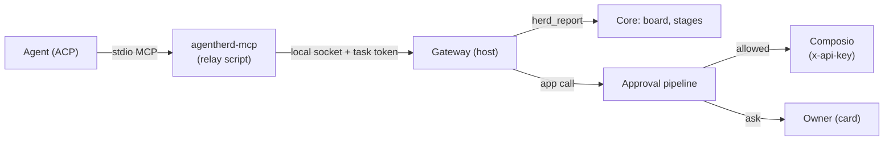

# 09. Agent tools and apps

Applied ADRs: [0019](../adr/0019-relay-verbatim-board-and-reports.md),
[0029](../adr/0029-only-mass-deletes-ask-the-owner.md),
[0056](../adr/0056-leaving-the-mac-asks-and-questions-close.md),
[0041](../adr/0041-agent-tools-through-a-local-mcp-gateway.md),
[0060](../adr/0060-pi-tools-through-the-mcp-gateway.md).

AgentHerd gives every task one MCP server, `agentherd`. Through it the agent reports progress
(`herd_report`) and, when the owner has connected apps, uses them (Gmail, Slack, GitHub …)
through [Composio](https://composio.dev) with the owner's own Composio key.

## 1. Gateway

### How an agent gets it

- `session/new` and `session/load` carry
  `mcpServers: [{ name: "agentherd", command, args, env }]` (stdio). `command`/`args` run
  `packages/host/bin/agentherd-mcp.ts` with the host's Node (`process.execPath`, `ELECTRON_RUN_AS_NODE=1` in the
  app). `env` has `AGENTHERD_MCP_SOCKET` (the gateway socket) and `AGENTHERD_MCP_TOKEN`.
- A profile with `mcp: false` gets `mcpServers: []` as before. The Pi bridge (`packages/pi-acp`,
  ADR 0060) queries `tools/list` on stdio `mcpServers` when a session starts or loads and
  registers their tools in Pi via `extension/mcp.ts`.
- The relay script does no MCP itself: it reads newline-delimited JSON-RPC from stdin, sends each
  message to the socket with the token, and writes the answers to stdout. When the socket closes
  it exits.

### Socket and token

- The gateway socket sits next to the host socket: `<home>/run/mcp.sock` (mode 600, directory
  700) or the named pipe `\\.\pipe\agentherd-mcp-<hash of home>` on Windows. No TCP listener.
- The token is 32 random bytes per task, made when the task's session starts and dropped when the
  task ends. A message with an unknown token is answered with a JSON-RPC error and closes the
  connection. The token is never written to the audit log or the transcript.

### MCP subset

| Method | Answer |
| --- | --- |
| `initialize` | `protocolVersion` as asked (fallback `2025-06-18`), `capabilities: { tools: {} }`, server info `agentherd` |
| `notifications/initialized`, other notifications | Ignored |
| `ping` | `{}` |
| `tools/list` | `herd_report`, `herd_ack` plus the app tools (§3), one page |
| `tools/call` | §2 / §3; errors are tool results with `isError: true`, not JSON-RPC errors |
| anything else | JSON-RPC error `-32601` |

## 2. `herd_report`

Input as in [04-herder.md §2](04-herder.md): `state` (`progress`, `waiting`, `ready`, `blocked`,
`failed`, `dropped`), `summary` (one or two sentences for the owner, ≤ 100 words; longer is
refused with a tool error, [ADR 0049](../adr/0049-short-messages-written-by-the-agent.md)), optional `changes`, `tests`,
`risks`, `links` (strings). The gateway validates it, hands it to the core for the task the token
belongs to, and answers `"reported"`. The core treats it as the agent report source of 04-herder
§2.

`herd_ack(text)` ([ADR 0046](../adr/0046-tell-the-owner-at-the-right-time.md), ADR 0049): one line
(≤ 30 words) sent to the owner at once, labeled with the task, as a reply to the owner's message
that started the turn when there is one. Once per turn, only while a turn runs, and not in turns
AgentHerd started itself; otherwise, or when longer, the answer is a tool error. In a turn the
owner did not ask for directly (the Herder started it, or its pull request woke it) the line only
goes on the task board ([ADR 0061](../adr/0061-small-news-on-the-board.md)).

## 3. Apps through Composio

### Setup (desktop app, 应用连接 → 应用)

1. The owner pastes a Composio API key (from platform.composio.dev). The host checks it with one
   API call and stores it in `secrets.json` under `composio`; the UI can replace or remove it, never
   read it.
2. The app lists toolkits with their state (`已连接` / `未连接`), from the Composio session's
   toolkit list. A search field finds more toolkits by name or slug (case-insensitive, with
   surrounding spaces ignored). Description-only matches are hidden, including connected apps
   that do not match. The current search stays in force while requests are pending or connection
   events arrive; an older search response cannot replace a newer one. Search results do not
   overwrite the default list. Clearing the field restores that list immediately, without waiting
   for the background refresh. Default and search lists show five apps at a time, connected apps
   first (counting toward the five). **显示更多** reveals another five already loaded rows without
   a network request and disappears when all are visible. Changing or clearing the search resets
   the visible count to five.
3. **连接** asks Composio for an authorization link for that toolkit and opens it in the browser;
   the app polls until the connection is active (or 5 minutes pass). **断开** deletes the connected
   account.
4. `apps.composioUserId` in `config.json` is made once (`agentherd-<16 hex>`) and used as the
   Composio `user_id` for every call.

### Composio session

The host keeps one Composio tool-router session (REST v3.1,
`POST https://backend.composio.dev/api/v3.1/tool_router/session`) for the user id, created on
first use and again after a connection changes or the key changes. Its config:

- `manage_connections.enable: false` (connecting is done in the app),
- `workbench.enable: false` (no remote code sandbox),
- toolkits: the connected ones.

The gateway is an MCP client of the session's hosted MCP endpoint (`mcp.url`, header
`x-api-key`). `tools/list` returns Composio's tools (search, schema and execute meta tools) after
`herd_report`; `tools/call` for them is forwarded after the approval step below. Without a key, or
when Composio cannot be reached, only `herd_report` is listed; a call then gets an error result
saying why.

### Approval

Before a call is forwarded the gateway finds the app tools it would run: the tool itself, or
for an execute meta tool (`COMPOSIO_MULTI_EXECUTE_TOOL`) each `tool_slug` in its arguments. Search
and schema meta tools run no app tool and are forwarded directly. For each app tool it reads the
tool's hints (Composio tool tags `readOnlyHint`, `destructiveHint`, …; cached per slug for a
day) and makes one item per call. When one call runs several app tools, the item lists them all
and is decided by the strictest of them (owner > approved):

| Field | Value |
| --- | --- |
| `kind` | `permission` |
| `toolCall.kind` | `app` |
| `toolCall.title` | `<toolkit name>: <tool name>`, e.g. `Gmail: Send Email` |
| `toolCall.command` | the tool slug, e.g. `GMAIL_SEND_EMAIL` |
| `toolCall.rawInput` | the arguments |
| `toolCall.appHints` | the hints |

The pipeline (04-herder §3) decides with these steps, after mass delete, `extraGuards` and the
leaving-the-Mac check: a slug that sends, replies, forwards, posts, publishes, comments, invites,
shares or merges, or creates a pull request or issue, asks the owner unless the task allowed that
step (ADR 0056):

| Tool | `assist` / `auto` | `observe` |
| --- | --- | --- |
| `readOnlyHint` | approved | approved |
| `destructiveHint`, or no hints known | owner | owner |
| any other (create, update) | approved, in the audit log and the report | owner |

Owner rules apply as for commands: a rule with `toolKind: "app"` and a `command` glob on the slug
(`GMAIL_SEND_*`) allows or denies. "Always do this" on an app card creates such a rule for that
slug. A denied call is answered with an error result `"The owner did not allow <title>."`; the
agent continues.

The card shows the title, the toolkit and the arguments as JSON, at most 20 lines, after
redaction (06-security §2).

### What the Herder knows

- `session_list` gains a line `Connected apps (agents use them through their agentherd tools): Gmail, GitHub`
  (nothing without a key or without connected apps). The names are the ones last read from Composio;
  the host reads them at start and after each change.
- When the owner's request needs an app, the Herder says in `addedContext` which apps the task can
  use through its agentherd tools.
- The Herder has no app tools.

### Which Composio tools agents see

- Listed and forwarded directly: `COMPOSIO_SEARCH_TOOLS`, `COMPOSIO_GET_TOOL_SCHEMAS`.
- Listed, approved per app tool: `COMPOSIO_MULTI_EXECUTE_TOOL` (slugs from `arguments.tools[].tool_slug`)
  and any direct app tool.
- Never listed and refused: `COMPOSIO_MANAGE_CONNECTIONS`, `COMPOSIO_REMOTE_WORKBENCH`,
  `COMPOSIO_REMOTE_BASH_TOOL`, `COMPOSIO_PROXY_EXECUTE`, `COMPOSIO_WAIT_FOR_CONNECTIONS` (connecting is
  done in the app; the other ones run code or raw requests no hint describes).
- A slug Composio does not describe (`GET /tools/{slug}` fails) has no hints and goes to the owner.

The settings use a second session with no toolkit filter, only to list toolkits and to get
sign-in links; a session Composio no longer knows (404) is made again once.

## 3b. 小红书 and 知乎 (ADR 0058)

The host runs a pinned [xiaohongshu-mcp](https://github.com/xpzouying/xiaohongshu-mcp) release on
`127.0.0.1` (random port, bearer token, cookies in `~/.agentherd/xiaohongshu/`) while 小红书 is
turned on in 应用连接 (risk notice accepted, QR sign-in). Its MCP tools reach agents beside the
Composio ones as `XIAOHONGSHU_<TOOL>` (`get_login_qrcode` and `delete_cookies` hidden); the
approval rules above apply, and publish/comment/reply/like/favorite leave the Mac (ADR 0056).
Notices for the owner come from its REST API (`notifications/unread`, `notifications/list`), not
from agents.

知乎 has no maintained server and its web API signs requests, so the host keeps a headless Chrome
with its own profile (`~/.agentherd/zhihu/profile`, signed in by the site's QR code) and calls the
API from inside a zhihu.com page, whose session does what the site needs. Its tools are ours,
named `ZHIHU_<TOOL>`: `SEARCH`, `HOT_LIST`, `GET_QUESTION`, `GET_ANSWER`, `GET_ARTICLE` (read from
the article page), `GET_COMMENTS`, `GET_MY_PROFILE`, `LIST_NOTIFICATIONS` read; `POST_COMMENT`,
`REPLY_COMMENT` and `VOTE_UP` write and ask. Notices come from
`/api/v4/notifications/v2/{default,vote_thank,follow}` (「等你来答」 invitations left out); reading
them does not mark them read.

## 3c. 飞书, news sources and notes (ADR 0059)

**飞书** is the official [lark-cli](https://www.npmjs.com/package/@larksuite/cli), signed in as the
owner. The host finds it (PATH, `~/.local/bin`, Homebrew) or installs it with
`npm install -g @larksuite/cli`, sets it up with AgentHerd's own Feishu app when it has none, and
signs in with `auth login --no-wait --json --domain …` (QR in 应用连接, `--device-code` finishes
in the background). It is not a gateway tool: every new task gets one paragraph saying lark-cli is
signed in, as whom, and where its guides are (`lark-cli skills read lark-doc`), and the agent runs
it with its shell. `outboundCheck` reads lark-cli commands: reads, `--help`, `--dry-run`, `auth`,
`config`, `schema` and `skills` stay on the Mac; `+create` of a doc, sheet, slides, base or mind
note passes (the owner's own space); im, mail, calendar, vc and approval writes ask as `send`;
other writes and non-GET `lark-cli api` ask as `edit`.

**News sources** need no sign-in and are on unless switched off in 应用连接 → 资讯: GitHub Trending
(the web page; daily, weekly or monthly, per language), Hacker News (front page, best stories,
Algolia search) and arXiv (export API, newest first). Agents get `GITHUB_TRENDING`,
`HACKER_NEWS` and `ARXIV_SEARCH` beside the Composio tools, read-only, never asking. The Herder
reads them with `feed_read` (04-herder).

**Notes.** Notion is a Composio app (§3). An Obsidian vault folder set in 应用连接 → 笔记
(`obsidianVault` in config.json, checked to exist) is told to every new task like lark-cli.

## 4. Failure behavior

| Case | Behavior |
| --- | --- |
| Relay script cannot reach the socket | It exits with an error; the agent reports the MCP server failed; the task runs without it |
| Token unknown or task ended | JSON-RPC error, connection closed |
| Composio returns an error (bad key, quota, app error) | Error result with Composio's message; key problems also show in 设置 |
| Composio unreachable | Error result; `tools/list` shows only `herd_report` |
| The owner does not answer an app card | As any item (04-herder §3); the call waits |
| The gateway crashes | No error path forwards a call: an open app call ends with an error result |

## 5. Tests

- Gateway: `initialize`/`tools/list`/`tools/call`/`ping`, unknown method, bad token, socket per
  platform; the relay script end to end with a fake socket.
- `herd_report` reaches the core and changes the stage (e2e with the mock agent calling the tool).
- Approval: hints → decision table above in every mode; rules on `app`; multi-execute with mixed
  tools makes one item decided by the strictest.
- Composio client with a fake `fetch`: session config, key check, connect link, disconnect,
  hosted MCP forwarding, errors.
- `session/new` and `session/load` carry the server; `mcp: false` and the Pi bridge do not break.
